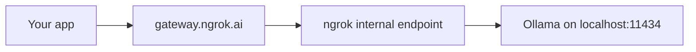

_Last verified against both products' documentation on October 19, 2026._

If you're looking for an alternative to Cloudflare AI Gateway, ngrok AI Gateway is a hosted LLM gateway that gives you one OpenAI- and Anthropic-compatible endpoint for hosted model providers and for models you run yourself.
The biggest difference between the two is what happens when your model runs on your own hardware: ngrok AI Gateway can reach a model on your laptop, an office GPU server, or a private network without exposing it to the public internet.

**The short answer:**

- **Choose ngrok AI Gateway** if you run local or self-hosted LLMs, such as Ollama, vLLM, or LM Studio, and want them behind the same endpoint, keys, and failover as OpenAI and Anthropic.
  It's also a fit if you want automatic failover without building routes, per-key control over which providers and models each app can call, and a flat per-token fee that doesn't grow with model price.
- **Choose Cloudflare AI Gateway** if you need caching, guardrails, DLP, and spend limits enforced at the gateway.
  It's also the better fit for routing you can change without touching client code, for log export to OpenTelemetry, and for non-chat modalities like speech, image, video, and realtime WebSockets.

The rest of this page explains each difference and links to the primary documentation behind it.

## What each product is

**Cloudflare AI Gateway** is a proxy that runs on Cloudflare's network between your application and AI providers.
You create named gateways in your Cloudflare account, send requests through them, and get analytics, logging, caching, rate limiting, retries, and fallbacks ([Cloudflare docs](https://developers.cloudflare.com/ai-gateway/)).
Since August 2026, Cloudflare treats AI Gateway and Workers AI as one "AI control plane", so the same API and billing cover Cloudflare-hosted models and third-party providers ([Cloudflare blog](https://blog.cloudflare.com/workers-ai-gateway-unification/)).

**ngrok AI Gateway** (ngrok.ai) is a hosted gateway at `gateway.ngrok.ai`, managed at `app.ngrok.ai`.
You send requests with an ngrok access key, and the gateway resolves the model, picks credentials, forwards the request, and fails over to another key or model when a provider errors ([ngrok docs](/ai-gateway/how-it-works)).
Because it's built by ngrok, it can route to ngrok internal endpoints, which is how it reaches models that aren't on the public internet.

Both products speak the OpenAI Chat Completions, OpenAI Responses, and Anthropic Messages formats, so switching between them, or away from either, is mostly a base URL and key change.

## At a glance

| | Cloudflare AI Gateway | ngrok AI Gateway |
|---|---|---|
| **Local and private models** | Custom providers need an HTTPS `base_url`; the AI Gateway docs describe no path to a private network | ngrok internal endpoints reach models on your machine or private network with no public URL |
| **HTTP model servers** | Not supported; custom providers must use HTTPS | Supported on ngrok `.internal` endpoints, so local servers don't need TLS |
| **Local-to-hosted fallback** | Through a Dynamic Routing flow you build | List models in the request, such as `["ollama:llama3.2", "openai:gpt-4o"]` |
| **First-party hosted open models** | Yes, Workers AI | No |
| **APIs** | Chat Completions, Responses, Messages, `/ai/run` for all modalities, provider-native passthrough for 24 providers, WebSockets | Chat Completions, Responses, Messages, Gemini `generateContent`, Files, Models |
| **Failover** | Retries up to 5 attempts; cross-model fallback through Dynamic Routing | Automatic across your keys, resellers of the same model, and fallback models, up to 10 attempts |
| **Where routing lives** | On the gateway (Dynamic Routing flows, versioned) | In each request (`models` array) or `ngrok/auto` |
| **Per-app access control** | API tokens are account-scoped across all gateways | Each access key gets its own provider and model allowlist |
| **Caching** | Exact-match response caching | Not available |
| **Guardrails and DLP** | Llama Guard guardrails and DLP that can flag or block requests | Not available |
| **Rate and spend limits** | Per-gateway rate limits and dollar spend limits | Account-wide token caps per request |
| **Request bodies stored by default** | Yes, logs include prompts and responses unless turned off | No, body capture is opt-in |
| **Exports** | Logpush, OpenTelemetry, GraphQL | Usage API with a per-attempt failover trace |
| **Gateway fee** | Free; 5% fee when buying managed credits | $0.05 per million tokens on every successful request, including self-hosted models |

## Local and self-hosted LLMs

Running your own model is common for privacy, cost, or offline development: Ollama on a laptop, LM Studio on a workstation, or vLLM on a GPU server in your office or cloud account.
The hard part is putting that model behind the same gateway as your hosted providers without opening the model server to the internet.
This is where ngrok AI Gateway and Cloudflare AI Gateway differ the most.

### How ngrok AI Gateway reaches a local model

ngrok AI Gateway routes to a self-hosted model through an ngrok internal endpoint ([ngrok docs](/ai-gateway/guides/use-a-model-you-run-yourself)).
An internal endpoint is a `.internal` URL that's private to your ngrok account and not reachable from the public internet.
The ngrok agent runs next to your model server and holds an outbound connection to ngrok, so you don't open inbound ports or set up a VPN.



Setup takes three steps.

**1. Expose the model server with an internal endpoint:**

```bash
ngrok http 11434 --url https://my-ollama.internal
```

**2. Register it as a custom provider** in [app.ngrok.ai](https://app.ngrok.ai) or with the API:

```bash
curl -X POST https://api.ngrok.ai/providers \
  -H "Authorization: Bearer $AI_GATEWAY_API_KEY" \
  -H "Content-Type: application/json" \
  -d '{
    "providerId": "my-ollama",
    "name": "Local Ollama",
    "baseUrl": "https://my-ollama.internal",
    "supportedApiSurfaces": [
      { "format": "openai", "surface": "chat-completions" }
    ],
    "models": [{ "modelId": "llama3.2" }]
  }'
```

**3. Call the model** through the gateway with `provider:model`, using the same SDK and access key you use for hosted models:

```python
from openai import OpenAI

client = OpenAI(
    base_url="https://gateway.ngrok.ai/v1",
    api_key="ng-xxxxx",  # your ngrok AI Gateway access key
)

response = client.chat.completions.create(
    model="my-ollama:llama3.2",
    messages=[{"role": "user", "content": "Hello"}],
)
```

Any server that speaks OpenAI Chat Completions, OpenAI Responses, or Anthropic Messages works as a custom provider, and ngrok has step-by-step guides for [Ollama](/ai-gateway/custom-providers/ollama), [vLLM](/ai-gateway/custom-providers/vllm), and [LM Studio](/ai-gateway/custom-providers/lm-studio) ([ngrok docs](/ai-gateway/concepts/custom-providers)).
Internal endpoints accept plain HTTP upstreams, so a local Ollama or vLLM server doesn't need its own TLS certificate.

### What you get once the local model is behind the gateway

A self-hosted model gets the same gateway features as a hosted provider:

- **Fallback from local to hosted.** If your GPU box is busy or offline, the request moves on to a hosted model in the same call ([ngrok docs](/ai-gateway/guides/configure-fallback-models)):

  ```json
  {
    "model": "my-ollama:llama3.2",
    "models": ["openai:gpt-4o-mini"],
    "messages": [{ "role": "user", "content": "Hello" }]
  }
  ```

- **Several machines as one pool.** Register each server as its own custom provider, such as `ollama-gpu-1` and `ollama-gpu-2`, and list them in `models` to fail over between them ([ngrok docs](/ai-gateway/custom-providers/ollama)).
- **Per-key access.** An access key configuration decides which keys can call your local provider, so a teammate's key can reach the office GPU while a production key can't ([ngrok docs](/ai-gateway/guides/access-key-configurations)).
- **Local models in coding agents.** ngrok's guides for Cursor, OpenCode, Pi, and Zed show how to add a self-hosted model like `ollama:llama3.2` next to hosted ones ([ngrok docs](/ai-gateway/agents)).
  Cursor's tool calls can fail against a self-hosted model even when plain chat works ([ngrok docs](/ai-gateway/agents/cursor)).
- **Automatic model selection.** `ngrok/auto` tries models from custom providers you've added a provider key for before it moves to hosted models ([ngrok docs](/ai-gateway/guides/automatic-model-selection)).

### What to know before you rely on it

- Internal endpoints require ngrok's Pay-as-you-go plan ([ngrok docs](/gateway/endpoints/internal-endpoints)).
- The ngrok agent must run under the same ngrok account as your AI Gateway, or the gateway can't reach the endpoint.
- The $0.05 per million tokens processing fee applies to self-hosted models too ([ngrok docs](/ai-gateway/concepts/credits)).
- ngrok AI Gateway doesn't serve `/v1/embeddings`, so you can't route a local embedding model through it for RAG.
- Local models can be slow on their first request while they load into memory; raise `perRequestTimeout` in [account settings](/ai-gateway/guides/account-settings) if requests time out during warm-up.

### How Cloudflare AI Gateway handles self-hosted models

Cloudflare AI Gateway supports custom providers, but its docs say the `base_url` must start with `https://` and that HTTP isn't supported ([Cloudflare docs](https://developers.cloudflare.com/ai-gateway/configuration/custom-providers/)).
The AI Gateway docs include a self-hosted example at an HTTPS hostname but don't describe how the gateway would reach a server on a private network or on `localhost`.
Cloudflare has other products for exposing private services, such as Cloudflare Tunnel, but the AI Gateway docs don't document using them with a custom provider.
In practice, by Cloudflare's docs, your model server needs to be served over HTTPS at an address Cloudflare can reach.

Cloudflare does offer something ngrok doesn't: Workers AI, which runs open models on Cloudflare's own infrastructure under the same API and bill as AI Gateway ([Cloudflare blog](https://blog.cloudflare.com/workers-ai-gateway-unification/)).
If what you want is open models without running hardware yourself, Workers AI covers that.
If you want to use hardware you already have, or keep the model inside your network, ngrok AI Gateway is built for that.

## Failover and routing

**ngrok AI Gateway fails over by default.**
When a provider returns a 401, 403, 429, 5xx, or 408, or the connection fails, the gateway tries the next option without any setup on your side ([ngrok docs](/ai-gateway/guides/error-handling)):

- An auth error moves to your next provider key, then to an ngrok-managed key, then to the next model.
- A rate limit moves to a different quota pool, then to an ngrok-managed key, then to the next model.
- A server error or timeout moves straight to the next model.

A bare model ID like `gpt-4o` also expands to every provider in the catalog that serves that model, with the model author's own provider tried first ([ngrok docs](/ai-gateway/guides/model-selection-strategies)).
Every response carries an `Ngrok-AIG-Model` header naming the model that actually answered, and the Usage API returns the full attempt chain with a `retryAction` reason for each step, so you can see exactly why a request failed over ([ngrok docs](/ai-gateway/guides/why-a-request-failed-over)).

**Cloudflare AI Gateway puts routing on the gateway.**
Gateway-level retries go up to 5 attempts with constant, linear, or exponential backoff ([Cloudflare docs](https://developers.cloudflare.com/ai-gateway/configuration/request-handling/)).
For fallback to a different model, Cloudflare's current mechanism is Dynamic Routing: a versioned flow of conditional, percentage-split, rate-limit, budget-limit, and model nodes, where each model node can have a fallback ([Cloudflare docs](https://developers.cloudflare.com/ai-gateway/features/dynamic-routing/)).
You can change a route or roll it back without changing client code, and you can A/B test models across up to five branches.
Dynamic routes accept the OpenAI Chat Completions shape only.

The trade-off: ngrok gives you resilient defaults with nothing to configure, but fallbacks live in each request.
ngrok's own FAQ answers "Can I set fallbacks on the gateway instead of in each request?" with "Not yet" ([ngrok docs](/ai-gateway/faq)).
Cloudflare gives you central, versioned routing control, but you build the flow yourself.

Both products offer automatic model selection.
Cloudflare's `cloudflare/auto` (public beta since September 30, 2026) picks from a Cloudflare-managed pool and pins one model per conversation turn to keep prompt caching working ([Cloudflare docs](https://developers.cloudflare.com/ai-gateway/features/auto-router/)).
ngrok's `ngrok/auto` classifies the prompt, picks within a price band, prefers your keyed custom-provider models, and sets the reasoning effort ([ngrok docs](/ai-gateway/guides/automatic-model-selection)).

## Access control and keys

**ngrok AI Gateway scopes control to each access key.**
You can give each app, environment, team, or customer its own access key, and attach a configuration that sets which providers and models that key may call, and which credentials pay for them ([ngrok docs](/ai-gateway/guides/access-key-configurations)).
A routing rule can try your own provider keys in order and then fall back to ngrok-managed credits when your keys hit auth errors or rate limits.
If a request asks for a model the key isn't allowed to use, the gateway skips it and names it in the `Ngrok-AIG-Rejected-Models` header.

**Cloudflare AI Gateway scopes by gateway, identity, or metadata.**
Cloudflare API tokens with AI Gateway permissions apply to every gateway in the account and can't be restricted to one gateway; Cloudflare recommends separate accounts or Worker bindings for isolation ([Cloudflare docs](https://developers.cloudflare.com/ai-gateway/configuration/authentication/)).
In exchange, Cloudflare goes further on identity: with Cloudflare Access on a custom domain, each request carries the user's SSO identity, which you can use for per-user spend limits, log filtering, and anomaly detection in User Insights ([Cloudflare docs](https://developers.cloudflare.com/ai-gateway/configuration/cloudflare-access/)).
ngrok's docs describe no per-user identity on gateway traffic.

For your own provider keys, Cloudflare stores them in Secrets Store and lets you keep several per provider under named aliases, selected with a `cf-aig-byok-alias` header ([Cloudflare docs](https://developers.cloudflare.com/ai-gateway/configuration/bring-your-own-keys/)).
ngrok stores provider keys account-wide, lets you rotate them in place, and fails over across them in the order you list.

## Caching, guardrails, and limits

Cloudflare AI Gateway has several gateway-side controls that ngrok AI Gateway doesn't offer today:

- **Caching:** exact-match caching of text and image responses, with a TTL from 60 seconds to one month and custom cache keys ([Cloudflare docs](https://developers.cloudflare.com/ai-gateway/features/caching/)).
  ngrok: "Response caching isn't currently available" ([ngrok docs](/ai-gateway/faq)).
- **Guardrails:** Llama Guard classifies prompts and responses across hazard categories plus prompt injection, and you can flag or block each category ([Cloudflare docs](https://developers.cloudflare.com/ai-gateway/features/guardrails/usage-considerations/)).
  Guardrails add latency and buffer streamed responses on some endpoints.
- **DLP:** scans prompts and responses with the same detection profiles as Cloudflare One ([Cloudflare docs](https://developers.cloudflare.com/ai-gateway/features/dlp/)).
  ngrok: automatic redaction "isn't available on ngrok.ai just yet".
- **Rate limits and spend limits:** per-gateway request limits, and dollar budgets by provider, model, or metadata ([Cloudflare docs](https://developers.cloudflare.com/ai-gateway/features/spend-limits/)).
  ngrok offers account-wide input and output token caps per request and an optional spending cap on credit auto top-up.

If gateway-enforced safety and budget controls are a hard requirement, Cloudflare AI Gateway is the better fit today.

## Observability and data handling

**Cloudflare AI Gateway exports more.**
It offers dashboard analytics, a GraphQL API, custom metadata on requests, custom costs, encrypted Logpush, and OpenTelemetry spans with `gen_ai` attributes ([Cloudflare docs](https://developers.cloudflare.com/ai-gateway/observability/otel-integration/)).

**ngrok AI Gateway explains failover better and stores less by default.**
Every response includes `Ngrok-AIG-Request-Id`, `Ngrok-AIG-Attempts`, `Ngrok-AIG-Model`, `Ngrok-AIG-Rejected-Models`, and `Ngrok-AIG-Removed-Params` headers, and the Usage API returns per-attempt cost and the reason for each failover step ([ngrok docs](/ai-gateway/observability)).
ngrok doesn't store request or response bodies unless you turn on request capture, which keeps them for 30 days; usage metadata is kept for 90 days.
Cloudflare logs prompts and responses by default; you can turn that off per gateway or per request ([Cloudflare docs](https://developers.cloudflare.com/ai-gateway/observability/logging/)).

Log storage also differs on cost.
Cloudflare accounts that create their first gateway on or after September 24, 2026 store logs in Workers Logs, which moves to Cloudflare Observability pricing on December 1, 2026 ([Cloudflare docs](https://developers.cloudflare.com/ai-gateway/reference/pricing/)).
ngrok has no separate log storage meter.

## Pricing

**Cloudflare AI Gateway's core features are free.**
If you buy Cloudflare's prepaid Unified Billing credits to pay for models, there's a 5% fee on the purchase and no markup on inference ([Cloudflare docs](https://developers.cloudflare.com/ai-gateway/reference/pricing/)).
Guardrails bill as Workers AI usage, and Logpush and log storage bill separately.

**ngrok AI Gateway charges a flat processing fee.**
Every successful request costs $0.05 per million tokens (input plus output), whether you pay with ngrok credits, your own provider keys, or a self-hosted model ([ngrok docs](/ai-gateway/concepts/credits)).
With credits, you also pay the model's cost.
ngrok doesn't bill requests that fail before reaching a provider.

What that means in practice:

- **With your own provider keys,** Cloudflare AI Gateway costs less, because it charges no per-token gateway fee.
- **With managed credits,** the fees break even at a blended model price of $1 per million tokens, because 5% of $1 is $0.05.
  Above that, which includes most frontier models, ngrok's flat fee is the smaller share.
  Below it, Cloudflare's 5% is cheaper.
- **With a self-hosted model,** ngrok charges only the processing fee, and inference costs you nothing beyond your own hardware.

## Coding agents

Both gateways document setup for coding agents, so you can route Claude Code, Codex, Cursor, and others through one key with usage tracking.

- **Cloudflare** has guides for Claude Code, Claude Desktop, Cursor, Gemini CLI, GitHub Copilot CLI, OpenAI Codex, OpenCode, Pi, VS Code, and Xcode ([Cloudflare docs](https://developers.cloudflare.com/ai-gateway/integrations/coding-agents/)).
- **ngrok** has guides for Claude Code, Codex, Cursor, Hermes, OpenCode, Pi, Zed, and other agents ([ngrok docs](/ai-gateway/agents)).
  The Cursor, OpenCode, Pi, and Zed guides show how to use a model on your own machine alongside hosted ones, and you can give each agent or teammate its own access key with its own model allowlist.

## Switch from Cloudflare AI Gateway to ngrok AI Gateway

If you use the OpenAI SDK, change the base URL and key:

```python
from openai import OpenAI

client = OpenAI(
    base_url="https://gateway.ngrok.ai/v1",
    api_key="ng-xxxxx",  # your ngrok AI Gateway access key
)

response = client.chat.completions.create(
    model="gpt-4o",
    extra_body={"models": ["anthropic:claude-sonnet-4-6"]},  # optional fallbacks
    messages=[{"role": "user", "content": "Hello"}],
)
```

For the Anthropic SDK, use `https://gateway.ngrok.ai` as the base URL.
Then replace any Cloudflare-specific pieces: `cf-aig-*` headers, `dynamic/<route>` model names, and `cloudflare/auto` map to the `models` array, `provider:model` names, and `ngrok/auto`.
To add a model you run yourself, follow [Use a model you run yourself](/ai-gateway/guides/use-a-model-you-run-yourself).
See the [ngrok AI Gateway quickstart](/ai-gateway/quickstart) to get an access key.

## Frequently asked questions

### Is ngrok AI Gateway a good alternative to Cloudflare AI Gateway?

Yes, especially if you run local or self-hosted LLMs.
ngrok AI Gateway reaches models on your machine or private network through ngrok internal endpoints, fails over across keys, providers, and models by default, and scopes each access key to specific providers and models.
It isn't a full replacement if you depend on Cloudflare's caching, guardrails, DLP, spend limits, Logpush, or OpenTelemetry export, which ngrok AI Gateway doesn't offer as of October 2026.

### How do I route requests to a local LLM like Ollama through ngrok AI Gateway?

With ngrok AI Gateway, run `ngrok http 11434 --url https://my-ollama.internal` next to Ollama, register `https://my-ollama.internal` as a custom provider in app.ngrok.ai, and call `my-ollama:llama3.2` at `https://gateway.ngrok.ai/v1`.
The model stays off the public internet, and you can fall back to a hosted model in the same request.
The same steps work for vLLM, LM Studio, and any server that speaks OpenAI Chat Completions, OpenAI Responses, or Anthropic Messages.

### Can Cloudflare AI Gateway connect to Ollama running on my laptop?

Cloudflare AI Gateway's docs require a custom provider's `base_url` to use HTTPS and don't describe how to reach a model on `localhost` or a private network.
By those docs, you'd need to serve Ollama over HTTPS at an address Cloudflare can reach.
ngrok AI Gateway reaches a local Ollama server through a private ngrok internal endpoint, and plain HTTP is fine.

### Can I use a self-hosted model with coding agents through ngrok AI Gateway?

Yes, in agents that let you pick an OpenAI-compatible model.
ngrok's guides for Cursor, OpenCode, Pi, and Zed show how to add a model like `ollama:llama3.2`.
Tool calls from Cursor can fail against a self-hosted model even when plain chat works.

### Does ngrok AI Gateway support caching like Cloudflare AI Gateway?

No.
As of October 2026, ngrok AI Gateway has no response caching.
Cloudflare AI Gateway offers exact-match caching with configurable TTLs.

### Which is cheaper, Cloudflare AI Gateway or ngrok AI Gateway?

It depends on how you pay for models.
With your own provider keys, Cloudflare AI Gateway charges no gateway fee and ngrok AI Gateway charges $0.05 per million tokens.
With managed credits, Cloudflare charges 5% of what you buy and ngrok charges $0.05 per million tokens, so ngrok is cheaper for models that cost more than $1 per million tokens.
For a self-hosted model, ngrok charges the same $0.05 per million tokens, and internal endpoints require ngrok's Pay-as-you-go plan.

### Do I need a Cloudflare account or the ngrok agent?

Cloudflare AI Gateway requires a Cloudflare account, and some features depend on other Cloudflare products, such as Secrets Store for stored keys, Workers AI for guardrails, and Cloudflare One for DLP profiles.
ngrok AI Gateway requires an ngrok account and credits; you need the ngrok agent only to connect a private or local model.

### Does ngrok AI Gateway work with the OpenAI and Anthropic SDKs?

Yes.
Set the base URL to `https://gateway.ngrok.ai/v1` for OpenAI SDKs or `https://gateway.ngrok.ai` for Anthropic SDKs, and use your ngrok access key.
ngrok also documents the Google Gen AI SDK, Vercel AI SDK, TanStack AI, and LangChain.
