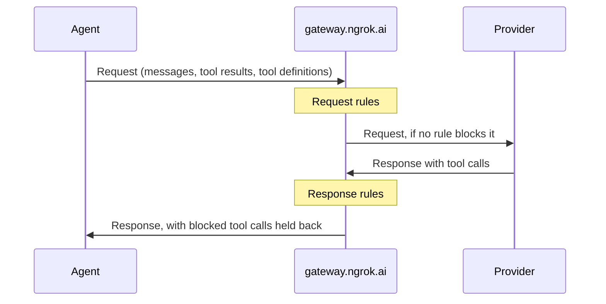

Firewall checks agent traffic that passes through the AI Gateway.
It reads what an agent sends to the model, and each tool call the model sends back, before your agent can run it.
When a check matches a rule, the gateway blocks the request or holds back the tool call, and tells the agent why.

You describe what to check in a **Firewall policy**: a named set of rules, a mode, and what to do when a check can't run.
You attach a policy to [access keys](/ai-gateway/concepts/access-keys), so every agent that uses those keys gets the same checks with no code changes.

To set one up, see [Guard agent tool calls with Firewall](/ai-gateway/guides/firewall-policies).

## Where checks run

Each rule runs at one of two points:

- **Request rules** run before the gateway sends the request to the model. They read the conversation, the results of tools the agent ran, and the tools the agent offers the model. A blocked request never reaches the model.
- **Response rules** run on each tool call the model returns. A blocked tool call is removed from the response, so your agent never receives it and can't run it.

Firewall checks [OpenAI Chat Completions](/ai-gateway/sdks/openai) (`/v1/chat/completions`) and [Anthropic Messages](/ai-gateway/sdks/anthropic) (`/v1/messages`) requests, both streamed and not streamed.

## Rules

Each rule has a type, which says how it matches, and a tier, which says what happens when it matches.

### Rule types

| Type | How it matches | Model call |
|------|----------------|------------|
| **Tool names** | Matches tool names exactly, with `*` as a wildcard. For example, `mcp__github__*` matches every tool from a GitHub MCP server. | No |
| **Regex** | Matches an [RE2](https://github.com/google/re2/wiki/Syntax) pattern against the text. For a tool call, the text is the tool name, a space, and the arguments. | No |
| **Decision** | A classifier model judges the text against a rule you write in plain language, such as "Deletes files outside the project directory." The rule matches when the classifier's confidence reaches the rule's threshold. | Yes |

Tool names and regex rules are fast and predictable.
Use a decision rule when the risk depends on intent or context that a pattern can't capture.

### What a rule reads

| Part | Checked | What it contains |
|------|---------|------------------|
| **Messages** | Before the model | System, developer, user, and assistant turns, including earlier tool calls. |
| **Tool results** | Before the model | The output of tools your agent ran, such as file contents or web pages. |
| **Tool definitions** | Before the model | The tools the request offers the model: names, descriptions, and parameters. |
| **Tool calls** | After the model | Each tool call the model returns. |

A rule reads either request parts or tool calls, not both.
Tool names rules read tool definitions or tool calls.

Decision rules on request parts read the system and developer messages and every turn after the most recent assistant turn.
That's the newest input, such as the latest user message and the tool results it carries.
Regex rules on request parts read the whole conversation.

### Tiers

| Tier | What happens when the rule matches |
|------|------------------------------------|
| **Hard block** | Always blocks. |
| **Soft block** | Blocks, unless an **Allow** rule in the same policy also matches at the same point. |
| **Allow** | Never blocks. It lets through something a soft block rule in the same policy would block. |

Use soft block and allow together for exceptions.
For example, soft block `git push` and allow pushes to your own fork.

## Mode and errors

A policy's **mode** decides whether matches block anything:

- **Enforce** blocks requests and tool calls that match a blocking rule.
- **Dry run** checks everything and reports what matched, but lets it all through. Use it to test a policy on real traffic before you enforce it.

A check can fail to run, for example when a decision rule's classifier times out.
**On error** decides what happens then:

- **Block** treats what it couldn't check as blocked. This only applies in Enforce mode.
- **Continue** lets it through and reports that it wasn't checked.

## Where a policy applies

| Scope | Applies to | Where you set it |
|-------|------------|------------------|
| **All access keys** | Every key in your account, including keys you create later. This policy is your **baseline**. | The policy's **Apply to** setting. |
| **Access key configurations** | Only keys that use a configuration that picks the policy. | The policy's **Apply to** setting, or the **Firewall** section of an [access key configuration](/ai-gateway/guides/access-key-configurations). |
| **One request** | A single request. | The [`plugins` field](/ai-gateway/reference/firewall#the-plugins-field) of the request body. |

An account has at most one baseline, and a configuration picks at most one policy.

### How policies combine

A request can be checked by up to three policies: the baseline, the policy of its key's configuration, and a policy in the request.
Firewall runs every rule from all of them, so a policy can add checks but never remove one:

- An allow rule only overrides soft block rules in its own policy. A request can't allow what your baseline blocks.
- The strictest mode wins, and it applies to every rule. If any of the policies uses Enforce, all of their rules block, including rules from a policy in Dry run.
- The strictest error setting wins. If any of the policies uses Block, a check that fails blocks.

<Warning>
A Dry run policy that applies next to an enforced one blocks too.
To try a policy in Dry run, test it with keys that no enforced policy applies to.
</Warning>

When you make a policy your baseline, configurations that picked the same policy stop picking it, so its rules don't run twice.

## What your agent sees

A block is not an HTTP error.
The gateway returns a normal `200` response, so your agent keeps working and the model can react to the block:

- **Blocked request**: the response holds one assistant message that says which rule blocked the request.
- **Blocked tool call**: the gateway replaces the call with assistant text that names the tool and the rule, and tells the model not to retry it with the same arguments.

The response also carries a `safeguard_results` field, and the `Ngrok-AIG-Firewall-Request` header reports request rule results.
See [What a blocked caller gets](/ai-gateway/reference/firewall#what-a-blocked-caller-gets) for the exact formats.

## Things to know

- **Other endpoints**: if a policy that applies to a key uses Enforce, the gateway rejects that key's requests to endpoints Firewall can't check, such as embeddings, with [`ERR_NGROK_27228`](/ai-gateway/reference/error-codes#err_ngrok_27228). In Dry run, those requests go through with the header `Ngrok-AIG-Firewall: unscreened; reason=unsupported_endpoint`.
- **Latency**: tool names and regex rules add almost no latency. Each decision rule calls a classifier, which can add up to 1.5 seconds before the check counts as failed.
- **Streaming**: in Enforce mode, the gateway holds each streamed tool call until its checks finish, so your agent never receives a call that wasn't checked. The rest of the stream keeps flowing.
- **Usage logs**: Firewall results don't appear in [usage logs](/ai-gateway/observability). Read the response headers and `safeguard_results` to see what Firewall did.

## Next steps

- [Guard agent tool calls with Firewall](/ai-gateway/guides/firewall-policies): Create a policy, try it, and apply it to keys.
- [Firewall reference](/ai-gateway/reference/firewall): Fields, limits, headers, and response formats.
- [Access key configurations](/ai-gateway/guides/access-key-configurations): Group keys that share a policy.
