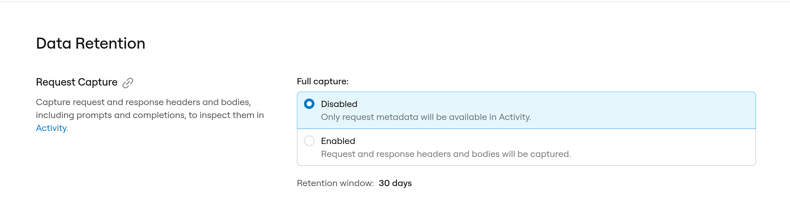

Account-wide gateway settings apply to every request through `https://gateway.ngrok.ai`, so you can set defaults like timeouts and token limits once instead of repeating them on every [access key configuration](/ai-gateway/guides/access-key-configurations).

## Timeouts

| Setting | Default | Description |
|---------|---------|-------------|
| `perRequestTimeout` | `15m` | Max time for a single upstream attempt |
| `totalTimeout` | `30m` | Max time for a request including all failover attempts |

If a single attempt exceeds `perRequestTimeout`, the gateway moves on to the next fallback.
If total time exceeds `totalTimeout`, the gateway returns an error.
`perRequestTimeout` must be less than or equal to `totalTimeout`.

### Streaming responses

Streams use the per-request timeout differently, so a long completion isn't cut off:

- The per-request timeout applies only until the provider sends the first byte.
  After that, the stream fails if the provider sends nothing for 30 seconds.
- The total timeout applies to the whole stream, including the time after the first byte.

<Warning>
A streaming response stops when `totalTimeout` expires.
If you lower it, make sure it still covers your longest streaming responses.
</Warning>

## Token limits

| Setting | Default | Description |
|---------|---------|-------------|
| `maxInputTokens` | none | Reject requests above estimated input tokens |
| `maxOutputTokens` | none | Cap completion length |

Leave token limits unset for no cap.
Set them to block oversized requests before they reach a provider.
Limits must be greater than zero.

`maxOutputTokens` also applies when your request doesn't set an output limit: the gateway adds one.
When your request asks for more, the gateway lowers it to your limit, and to the model's own maximum.

## Request capture

Request capture stores the request and response headers and bodies, including prompts and completions, for your request and each attempt the gateway sends to a provider.
You can inspect them in the [request details panel](/ai-gateway/observability/index#inspect-a-request-in-app-ngrok-ai) on the [Activity](https://app.ngrok.ai/activity) page.
Capture is off by default.

To turn it on:

1. Open [Settings > Data Retention](https://app.ngrok.ai/settings/data-retention) in app.ngrok.ai.
2. Under **Request Capture**, set **Full capture** to **Enabled**.
3. Select **Save**.

<Frame>
  
</Frame>

Capture applies to requests from then on. It doesn't fill in requests that were made while it was off.
Set **Full capture** to **Disabled** to stop capturing; only request metadata, such as tokens, latency, and cost, is then recorded.

What capture stores:

- Captures are kept for 30 days and then deleted.
- Each body stores up to 4 MB and each set of headers up to 16 KiB. Anything past the limit isn't stored.
- Headers with these names are redacted, in any letter case: `Authorization`, `Proxy-Authorization`, `Cookie`, `Set-Cookie`, `x-api-key`, `x-goog-api-key`, `api-key`, `api_key`, `apikey`, `access-token`, `access_token`, `accesstoken`, `token`, `bearer`, `secret`, and `password`.
- When the gateway calls a provider with an ngrok-managed key, the provider's response headers are redacted except `Content-Type`.
- Bodies are stored as sent, without redaction. The one exception is embedding vectors in embeddings responses, which are replaced with a placeholder that records the vector's dimensions and a SHA-256 hash.

<Warning>
Redaction matches whole header names only. A custom credential header with another name, such as `X-Auth-Token`, is stored as sent, and so is any secret inside a prompt or body.
</Warning>

Request capture is set in app.ngrok.ai only. The `/gateway-config` API doesn't read or change it.

## Via dashboard

1. Open [Settings](https://app.ngrok.ai/settings) in app.ngrok.ai
2. On **General**, edit **Total timeout**, **Per-request timeout**, and optional token limits
3. Save

**General** also shows the gateway URL (`https://gateway.ngrok.ai`).
The other Settings pages are **Data Retention** for [request capture](#request-capture), **Admin API Keys** for [AI Gateway API keys](/ai-gateway/concepts/access-keys#credentials-overview), and **Account**, which links to [dashboard.ngrok.com](https://dashboard.ngrok.com) for your account details and team members.

## Via the AI Gateway API

Get current settings:

```bash
curl https://api.ngrok.ai/gateway-config \
  -H "Authorization: Bearer $AI_GATEWAY_API_KEY"
```

Update settings (omitted fields keep their current values):

```bash
curl -X PATCH https://api.ngrok.ai/gateway-config \
  -H "Authorization: Bearer $AI_GATEWAY_API_KEY" \
  -H "Content-Type: application/json" \
  -d '{
    "perRequestTimeout": "60s",
    "maxInputTokens": 128000,
    "maxOutputTokens": 8192
  }'
```

Clear a token limit by sending `null`:

```bash
curl -X PATCH https://api.ngrok.ai/gateway-config \
  -H "Authorization: Bearer $AI_GATEWAY_API_KEY" \
  -H "Content-Type: application/json" \
  -d '{ "maxInputTokens": null }'
```

Duration fields use Go duration strings (for example, `30s`, `2m`).

See the [Gateway configuration API reference](/ai-gateway/api-reference/gateway-config/get).

## Next steps

- [How It Works](/ai-gateway/how-it-works): Request flow and failover
- [Choose how to reach providers](/ai-gateway/guides/configuring-providers): Credits, provider keys, and self-run models
- [Access Key Configurations](/ai-gateway/guides/access-key-configurations): Per-key scope and routing
