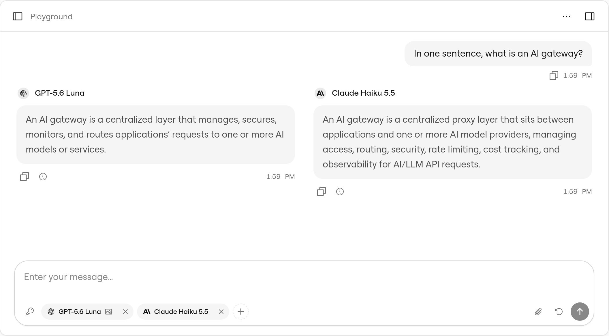
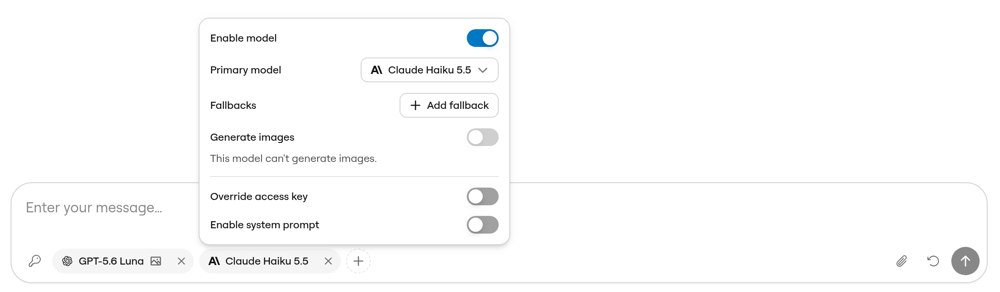
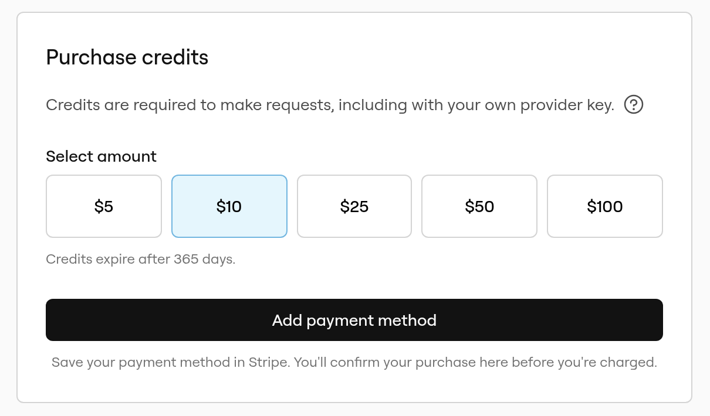

The playground in [app.ngrok.ai](https://app.ngrok.ai/playground) sends prompts through the AI Gateway from your browser.
Use it to try a model before you write any code, or to send the same prompt to up to three models and compare their answers side by side as they stream in.

Playground requests are real gateway requests.
They use one of your [access keys](/ai-gateway/concepts/access-keys), they're billed like any other request, and they appear on the [Activity](https://app.ngrok.ai/activity) page.

## What you'll need

- An ngrok account. Sign in at [app.ngrok.ai](https://app.ngrok.ai).
- [Credits](/ai-gateway/concepts/credits) in your AI Gateway account. Every request needs a positive balance, including requests that use your own provider keys.

## Open the playground

Select **Playground** in the app.ngrok.ai sidebar.

From any other page, you can open the playground as a side panel with the playground button in the page header.
Select **Open page** in the panel to switch to the full page.
The panel and the page show the same conversation.

## Compare models

The playground starts with one model selected. Its chip sits at the bottom of the message box, next to the key icon.

1. Select the key icon to choose an access key.
   Every model uses this key unless you [override it](#configure-each-model).
2. Select **+** (**Add model**) and pick a model to compare.
   Repeat to add a third model.
3. Type a prompt and press **Enter**, or select **Send message**.

Each model answers in its own column, streamed as tokens arrive.
Follow-up prompts go to every enabled model, and each model keeps its own conversation history.

<Frame>
  
</Frame>

The model list shows only models the access key can use.
If the key has an [access key configuration](/ai-gateway/guides/access-key-configurations) that restricts providers or models, the rest are left out.

## Configure each model

Select a model's chip in the message box to open its settings:

| Setting | What it does |
|---------|--------------|
| **Enable model** | Turn off to stop sending new prompts to this model. Its earlier answers stay in the conversation. |
| **Primary model** | Switch this column to another model. |
| **Fallbacks** | Select **Add fallback** to add [fallback models](/ai-gateway/guides/configure-fallback-models) the gateway tries, in order, if the primary model fails. |
| **Override access key** | Send this model's requests with a different access key than the rest. |
| **Enable system prompt** | Add a system prompt for this model only. |

Models that support reasoning also show a thinking effort or budget setting, and models that can create images show image generation settings.

<Frame>
  
</Frame>

## See what the gateway did

Select the **Response details** icon under an answer, or hover over it, to see:

- A timing waterfall with the time to the first token and the total time.
- The input and output tokens, when the model reports them.
- Which model answered, when a fallback answered for the primary model.
- **View in Activity**, which opens the request in the [request details panel](/ai-gateway/observability/index#inspect-a-request-in-app-ngrok-ai) with its attempts, timing, and cost.

## Get the code

To make the same request from your app, open the **Playground actions** menu and select **Get code**.
The snippet reproduces the conversation with the first model, including its fallbacks.

## If your balance runs out

When your credit balance reaches \$0, the gateway rejects new requests, so the playground is covered by a **Purchase credits** form.
Pick an amount and complete the purchase. When your credits arrive, the form closes and you can send prompts again.
If you haven't saved a card yet, you add one in Stripe first, then return to the playground and confirm the purchase there. Saving a card doesn't charge you or add credits by itself.

<Frame>
  
</Frame>
See [Purchasing credits](/ai-gateway/concepts/credits#purchasing-credits) for amounts and limits.

To avoid running out, turn on [automatic top-up](/ai-gateway/concepts/credits#automatic-top-up).

## Limits

- **Models**: up to three models per prompt.
- **Access keys**: the access key menu lists only keys whose value ngrok.ai has stored, which is every key created since late July 2026. Older keys don't appear. If you have no usable key, the playground creates one named **Playground Key**.
- **Sessions**: conversations are saved in your browser under **Saved sessions**, not in your ngrok account, so they don't follow you to another browser or device.
- **Billing**: playground requests cost the same as requests from your app and count toward your usage.

## Next steps

- [Inspect a request](/ai-gateway/observability/index#inspect-a-request-in-app-ngrok-ai): See attempts, timing, and captured bodies for a request
- [Configure fallback models](/ai-gateway/guides/configure-fallback-models): Add fallbacks to requests from your app
- [Credits](/ai-gateway/concepts/credits): How usage is billed and how to add credits
- [SDK integration](/ai-gateway/sdks): Call the gateway from your code
