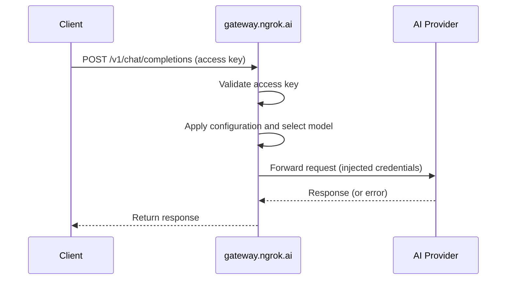

## Request flow

When you send a request to `https://gateway.ngrok.ai`:

1. **Your app sends a request** with your [access key](/ai-gateway/concepts/access-keys) to `https://gateway.ngrok.ai`
2. **The gateway validates the key** and loads its [access key configuration](/ai-gateway/guides/access-key-configurations)
3. **The gateway resolves the model** from your request body
4. **Provider credentials are selected** from the configuration's routing rules: a key ngrok.ai supplies when you pay with credits, or your stored [provider keys](/ai-gateway/guides/attaching-provider-keys)
5. **Unsupported parameters are stripped** for the chosen model before forwarding, and listed in the `Ngrok-AIG-Removed-Params` [response header](#response-headers)
6. **The request is forwarded** to the upstream provider
7. **On failure, the gateway retries** with the next provider key or model candidate
8. **The response is returned** to your app and usage is recorded

Manage keys, configurations, providers, and credits at [app.ngrok.ai](https://app.ngrok.ai).
Your apps send traffic to `gateway.ngrok.ai`.

## Authentication

Every request must include a valid **access key**.
Send it as `Authorization: Bearer ng-xxxxx-g1-xxxxx` (OpenAI-compatible APIs) or `x-api-key` (Anthropic native API).

Provider keys stay in [app.ngrok.ai](https://app.ngrok.ai).
The AI Gateway injects those from your configuration after validating the access key.

## Response headers

Every response from `gateway.ngrok.ai` carries ngrok's own headers describing how the gateway handled the request.

| Header | Value | When present |
|--------|-------|--------------|
| `Ngrok-AIG-Request-Id` | The request's ID. Use it to look the request up afterwards. | Every response, including rejections and errors. |
| `Ngrok-AIG-Attempts` | How many upstream attempts the gateway made. | Once the gateway tries a provider, on both success and failure. Absent when the request failed before any attempt, such as a malformed body or an unknown model. |
| `Ngrok-AIG-Model` | The upstream model that produced the response. | Success only. |
| `Ngrok-AIG-Rejected-Models` | Comma-separated models from your request that never ran, for example because the access scope blocks them or no credentials are available. Lists at most 4 models. | Once the gateway tries a provider, when at least one requested model was dropped. |
| `Ngrok-AIG-Replaced-Models` | The retired model your request named and its replacement that served, as `retired=replacement` catalog IDs. See [Replace retired models](/ai-gateway/guides/retired-model-fallback). | Success only, when the attempt that served used a replacement. |
| `Ngrok-AIG-Removed-Params` | Comma-separated request fields the gateway didn't send to the provider that served the response, because that provider or model doesn't support them. | Success only, when the gateway removed at least one field. |
| `Ngrok-AIG-Firewall-Request` | The result of [Firewall](/ai-gateway/concepts/firewall) request rules, such as `flagged; rules=force-push`. | When a Firewall policy with request rules checks the request. |
| `Ngrok-AIG-Firewall` | `unscreened` and a reason, when Firewall let traffic through without checking it. | When a Firewall policy applies but couldn't check the request or response. |

All of these are exposed through CORS, so browser clients can read them.
See the [Firewall reference](/ai-gateway/reference/firewall#response-headers) for every Firewall header value.

These are ngrok's headers rather than the provider's, so a managed-key caller and a [Bring Your Own Keys](/ai-gateway/concepts/bring-your-own-keys) caller see the same values.
Provider rate-limit headers behave differently: the gateway forwards those only when the attempt used your own provider key.

### The model header is authoritative

The gateway passes the response body through byte-for-byte, unless a [Firewall](/ai-gateway/concepts/firewall) policy blocks a tool call or adds `safeguard_results`.
The `model` or `modelVersion` field inside the body is the provider's own word and is never rewritten to name the model that served the response.
On a multi-model failover the body can therefore name a different model than the header.
Read `Ngrok-AIG-Model` when you need to know what answered.

### Streamed responses

On a streamed response the headers commit with the first flushed byte.
The attempt count is final at that point, because the gateway can't retry once bytes have reached your client.

### Trace IDs aren't a substitute

`Ngrok-Trace-Id` is emitted only when the trace is sampled, it isn't exposed through CORS, and it identifies the whole client request rather than a single attempt.
Use `Ngrok-AIG-Request-Id` to identify a request.

## Model selection

The gateway determines which model and provider to use from your request.

| Model in request | What happens |
|------------------|--------------|
| `gpt-4o` | Catalog lookup → OpenAI first, then other providers that serve the same model |
| `openai:gpt-4o` | Explicit OpenAI routing |
| `your-provider:your-model` | A [model you run yourself](/ai-gateway/guides/use-a-model-you-run-yourself) |
| `models` array | Fail over through listed models in order |
| `ngrok/auto` | ngrok.ai picks a model for each request. See [Automatic model selection](/ai-gateway/guides/automatic-model-selection) |

To choose model IDs and provider-qualified model names, see [Choose a model](/ai-gateway/guides/model-selection-strategies).

## Access key configurations

Configurations define:

- **Access scope**: allowed providers and models
- **Routing rules**: pay with credits or use your own provider keys, per provider

When a configuration has no routing rule for a provider, requests to that provider are paid with credits only.
Stored provider keys aren't used without a rule.

An access key without a configuration uses allow-all scope.
Built-in models you can [pay for with credits](/ai-gateway/reference/model-catalog#billing-and-provider-credentials) use an ngrok.ai key by default when you have [credits](/ai-gateway/concepts/credits).

## Failover

The gateway retries automatically when upstream requests fail.

### What triggers failover?

- Rate limits (HTTP 429)
- Auth errors (HTTP 401 or 403) because the provider rejected the key
- Timeouts, server errors (HTTP 5xx), and connection failures

Other 4xx errors return to your client right away, because another model would fail the same way.

### Failover order

What the gateway tries next depends on the error:

- **Auth error or rate limit**: the next provider key in the routing rule step.
  When no keys are left and the rule has an `ngrok` step after the **Bring your own API key** step, the gateway falls back to paying with credits.
- **Timeout, server error, or connection failure**: the gateway skips the remaining keys for that provider and moves to the next model.

The next model comes from your request's `models` array, or from another provider that serves the same model.
See [Handle gateway errors](/ai-gateway/guides/error-handling) for the full order.

A routing rule uses the first step that has usable credentials.
The gateway doesn't try later steps, except an `ngrok` step after a **Bring your own API key** step.

To attach several provider keys and control the order they're tried, see [Multi-key failover](/ai-gateway/guides/key-selection-failover).

## Timeouts and token limits

Configure account-level limits in [Account Settings](/ai-gateway/guides/account-settings).

| Setting | Default | Description |
|---------|---------|-------------|
| Per-request timeout | 15m | Max time for a single upstream attempt |
| Total timeout | 30m | Max time including all failover attempts |
| Max input tokens | none | Reject requests exceeding estimated input tokens |
| Max output tokens | none | Cap completion length |

For streaming responses, the per-request timeout applies only until the first byte.
After that, the stream runs until the total timeout, as long as the provider keeps sending data at least every 30 seconds.
See [Streaming responses](/ai-gateway/guides/account-settings#streaming-responses).

Request bodies are limited to 32 MiB.

## Next steps

<CardGroup cols={2}>
  <Card title="Access Keys" icon="key" href="/ai-gateway/concepts/access-keys">
    Create keys to authenticate requests
  </Card>
  <Card title="Access Key Configurations" icon="sliders" href="/ai-gateway/guides/access-key-configurations">
    Scope and route traffic per key
  </Card>
  <Card title="Choose a model" icon="route" href="/ai-gateway/guides/model-selection-strategies">
    Model IDs, provider prefixes, and custom provider models
  </Card>
  <Card title="Error Handling" icon="triangle-exclamation" href="/ai-gateway/guides/error-handling">
    How the gateway handles failures
  </Card>
</CardGroup>
