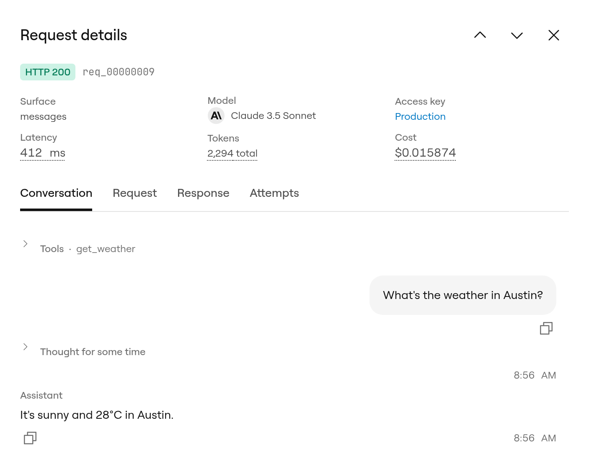
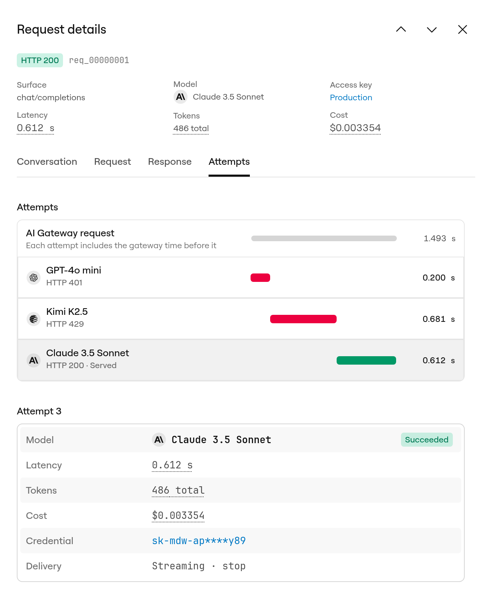

Monitor AI Gateway usage from [app.ngrok.ai](https://app.ngrok.ai) and the AI Gateway API.

<CardGroup cols={2}>
  <Card title="Usage" icon="chart-line" href="/ai-gateway/observability/index#usage-api">
    Query usage events and aggregated overview via the AI Gateway API
  </Card>
  <Card title="Debugging" icon="bug" href="/ai-gateway/guides/debugging">
    Troubleshoot failed requests and error codes
  </Card>
  <Card title="Error Codes" icon="triangle-exclamation" href="/ai-gateway/reference/error-codes">
    Reference for gateway error responses
  </Card>
</CardGroup>

## Identify a request

Every gateway response carries `Ngrok-AIG-Request-Id`, plus headers such as `Ngrok-AIG-Attempts`, `Ngrok-AIG-Model`, `Ngrok-AIG-Rejected-Models`, and `Ngrok-AIG-Removed-Params` that describe how the request was served.
Record the request ID in your application logs so you can tie a client-side failure to gateway usage data later.
See [Response headers](/ai-gateway/how-it-works#response-headers).

## Usage API

Query usage with the AI Gateway API:

```bash
curl "https://api.ngrok.ai/usage/overview?startTime=2026-10-01T00:00:00Z&groupBy=accessKey" \
  -H "Authorization: Bearer $AI_GATEWAY_API_KEY"
```

The overview returns daily cost, request, and error series for the window. `startTime` is required. Group by `provider` (the default) or `accessKey`.

[List individual usage events](/ai-gateway/api-reference/usage/list) to see one record per upstream attempt.
Each event reports the provider, model, status code, token counts, and a per-attempt cost breakdown.
Attempts of the same client request share a `requestId`.

By default the list returns only each request's terminal attempt.
Pass `includeRetries=true` to see the retries the gateway made along the way.

<Note>
When a provider reports no usage of its own, `usageEstimated` is `true` and the provider-reported token fields are all zero.
Read `inputTokensEstimate` and `outputTokensEstimate` on those attempts instead.
</Note>

## Look up one request

To see every attempt the gateway made for one request, pass its `Ngrok-AIG-Request-Id` to [`GET /usage/requests/{requestId}`](/ai-gateway/api-reference/usage/request-attempts). See [Why a request failed over](/ai-gateway/guides/why-a-request-failed-over).

## Inspect a request in app.ngrok.ai

The [Activity](https://app.ngrok.ai/activity) page lists your gateway requests, newest first, with each request's outcome, model, access key, tokens, and cost.
Select a row to open **Request details**, a panel that shows what your app sent, what came back, and every attempt the gateway made along the way.
You can also open it from **Recent attempts** on the Overview page, or from **View in Activity** under an answer in the [playground](/ai-gateway/guides/playground).

The top of the panel shows the HTTP status, the request ID, and a summary of the request: the API it used, the model that served it, the access key, latency, tokens, and cost.
Hover over the latency, token, or cost value for a breakdown.
Use the arrows next to the title to step through the requests in the list.
Each request and tab has its own URL, so you can share a link with someone on your account.

| Tab | What it shows |
|-----|---------------|
| **Conversation** | The messages, tool calls, and tool results in the request, followed by the model's reply. Embeddings requests show **Embeddings** instead, and [System One](/ai-gateway/guides/decisions-and-system-one) requests show **Evaluation**. |
| **Request** | The headers and body your app sent to the gateway. |
| **Response** | The headers and body the gateway returned to your app. For a streamed response, switch between **Overview** (the reconstructed output and stream milestones), **Events**, and **Raw**. |
| **Attempts** | Each attempt the gateway sent to a provider, in order, with its provider, model, outcome, timing, tokens, cost, and credential. Select an attempt to see the request the gateway sent the provider and the provider's response. |

<Frame>
  
</Frame>

The **Attempts** tab shows where time went.
Each attempt's latency breaks down into time in the gateway, time upstream, time to first token, and time spent thinking, and the attempts add up to the total request duration.
**Credential** shows **Managed by ngrok** when the attempt [paid with credits](/ai-gateway/guides/pay-with-credits), or the name of your [provider key](/ai-gateway/guides/attaching-provider-keys).

<Frame>
  
</Frame>

### What the panel needs

The summary and the **Attempts** tab work for every request.
Headers and bodies appear only for requests made while [request capture](/ai-gateway/guides/account-settings#request-capture) was on.
Capture is off by default.
Without it, the **Conversation**, **Request**, and **Response** tabs show **No content was captured** with a link to turn capture on for future requests.

### Limits

- **Retention**: captured headers and bodies are kept for 30 days. Request metadata, including attempts, timing, tokens, and cost, is kept for 90 days, so older requests still show their attempts after their bodies expire.
- **Size**: each captured body stores up to 4 MB, and each set of headers up to 16 KiB. The panel warns you when content past the limit is unavailable.
- **Redaction**: credential headers such as `Authorization`, `x-api-key`, `x-goog-api-key`, and `Cookie` are redacted and show as **Redacted**. On the **Request** tab, `Authorization` shows the name and ID of the access key that made the request instead. Bodies, including prompts and completions, are stored as sent.
- **Rejected requests**: a request the gateway rejects before it calls a provider, for example because your credit balance is empty or the access key is invalid, has no attempts, so it doesn't appear in the Activity list.
- **Dashboard only**: captured headers and bodies are available in app.ngrok.ai, not through the AI Gateway API. To read attempts from code, use [`GET /usage/requests/{requestId}`](/ai-gateway/api-reference/usage/request-attempts).

**Have feedback?** Email [niji@ngrok.ai](mailto:niji@ngrok.ai) with observability requests.
