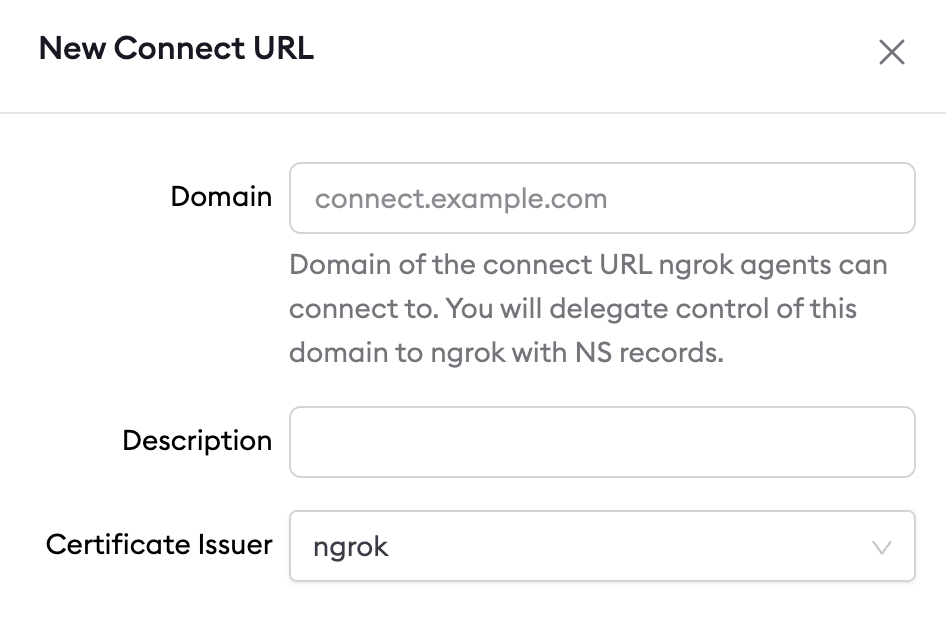
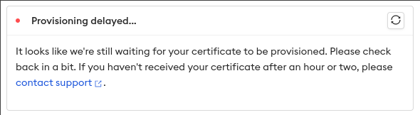

The Agent Connect URL is the hostname and port the ngrok agent (and SDKs) uses to establish its control connection to the ngrok service.
By default, agents use `connect.ngrok-agent.com:443`.
You can change this per agent by setting the [`connect_url`](/gateway/agent/config/v3/#connect-url) field in your configuration file.

## Custom agent connect URL

Create a custom agent connect URL to customize how your agents connect (for example
`connect.example.com:443`).
This involves delegating a DNS subdomain and
configuring certificates for the new address.

Key points:

- Agents connecting via your custom agent connect URL must authenticate to your
  ngrok account; connections using credentials from other accounts are rejected.
- Custom agent connect URLs support both ngrok‑issued and Let's Encrypt certificates.

### Create a custom agent connect URL

1. Choose a domain you own

- You will delegate a subdomain via `NS` records to ngrok so it can manage the
  required DNS (A/AAAA) and certificates.

2. Create the agent connect URL entry

- In the dashboard: https://dashboard.ngrok.com/connect-urls
- Or via API: [/api-reference/agentingresses/list/](/api-reference/agentingresses/list/)

3. Pick a certificate issuer

- ngrok Internal CA (fast, private CA, may require trust in some networks)
- Let's Encrypt (public CA, may require additional provisioning time)

### Delegate DNS records

After creation, the dashboard prompts you to add `NS` records for the selected
subdomain at your DNS provider.

### Update ngrok agent configuration

Point your agents at the new address by setting
[`connect_url`](/gateway/agent/config/v3/#connect-url).
The helper command
[`ngrok config add-connect-url`](/gateway/agent/cli/#ngrok-config-add-connect-url) can
update your config for you.

For example, if the domain of your custom agent connect URL is
`connect.example.com` then you might add the following line to the agent's
configuration file:

<Tabs>
	<Tab title="CLI">
		```bash
		ngrok config add-connect-url connect.example.com:443
		```
	</Tab>
	<Tab title="Agent Config">
		<CustomIngressAgentConfigExample />
	</Tab>
	<Tab title="SSH Reverse Tunnel">
		```bash
		ssh -R 443:localhost:80 v2@connect.example.com http
		```
	</Tab>
	<Tab title="Go">
		```go
		import (
			"context"
			"net"
			"os"

			"golang.ngrok.com/ngrok/v2"
		)

		func ngrokListener(ctx context.Context) (net.Listener, error) {
			agent, _ := ngrok.NewAgent(
				ngrok.WithAuthtoken(os.Getenv("NGROK_AUTHTOKEN")),
				ngrok.WithAgentConnectURL("connect.example.com:443"),
			)
			return agent.Listen(ctx)
		}
		```
	</Tab>
	<Tab title="Javascript">
		```jsx
		const ngrok = require("@ngrok/ngrok");

		(async function () {
			const session = await new ngrok.SessionBuilder()
				.authtokenFromEnv()
				.serverAddr("connect.example.com:443")
				.connect();

			const listener = await session
				.httpEndpoint()
				.listenAndForward("http://localhost:8080");

			console.log(`Ingress established at: ${listener.url()}`);
		})();
		```

		Javascript SDK Docs:

		- [https://ngrok.github.io/ngrok-javascript/classes/SessionBuilder.html#serveraddr](https://ngrok.github.io/ngrok-javascript/classes/SessionBuilder.html#serveraddr)
	</Tab>
	<Tab title="Python">
		```python
		import ngrok, asyncio

		async def create_listener() -> ngrok.Listener:
		    session: ngrok.Session = (
		        await ngrok.SessionBuilder()
		        .authtoken_from_env()
		        .server_addr("connect.example.com:443")
		        .connect()
		    )

		    return (await session.http_endpoint()
		        .listen_and_forward("http://localhost:8080"))

		listener = asyncio.run(create_listener())

		print(f"Ingress established at: {listener.url()}");
		```

		Python SDK Docs:

		- [https://ngrok.github.io/ngrok-python/session_builder.html#ngrok.SessionBuilder.server_addr](https://ngrok.github.io/ngrok-python/session_builder.html#ngrok.SessionBuilder.server_addr)
	</Tab>
	<Tab title="Rust">
		```rust
		use ngrok::prelude::*;

		async fn listen_ngrok() -> anyhow::Result<impl Tunnel> {
		    let sess = ngrok::Session::builder()
		        .authtoken_from_env()
		        .server_addr("connect.example.com:443")
		        .connect()
		        .await?;

		    let tun = sess
		        .http_endpoint()
		        .listen()
		        .await?;

		    println!("Listening on URL: {:?}", tun.url());

		    Ok(tun)
		}
		```

		Rust Crate Docs:

		- [https://docs.rs/ngrok/latest/ngrok/session/struct.SessionBuilder.html#method.server_addr](https://docs.rs/ngrok/latest/ngrok/session/struct.SessionBuilder.html#method.server_addr)
	</Tab>
	<Tab title="Kubernetes Controller">
		In your Helm values.yaml file, set

		```
		serverAddr: "connect.example.com:443"
		```
	</Tab>
</Tabs>

## Regional scope and GSLB

Custom agent connect URLs are pinned to a specific region for the agent's control
connection and do not use
[Global Server Load Balancing](/gateway/domains/global-load-balancer/) for that
connection.
End-user traffic to your endpoints is still delivered using GSLB.

## Dedicated IPs

When you create a custom agent connect URL, the DNS and certificates are branded to your domain, but the address still resolves to ngrok's shared IPs. 
If you need static, account-unique addresses, dedicated IPs are available.
[Contact Sales](mailto:sales@ngrok.com?subject=Dedicated+Ingress+IPs) for details.

## Certificate issuer

When you create a custom agent connect URL, choose one of two certificate issuers:

- ngrok's internal CA
- [Let's Encrypt](https://letsencrypt.org/)



### ngrok internal CA

- Default option; provisioned immediately.
- Trusted by the ngrok agent out of the box.
- Some enterprise inspection tools may not trust this private CA without
  additional configuration.

### Let's Encrypt

- Public CA; useful when corporate proxies or network devices can't trust
  a private CA.
- May require setting `connect_cas: host` (or providing the Let's Encrypt root)
  for some SDKs and for the SSH Reverse Tunnel agent.
- Provisioning can take time (DNS propagation). ngrok issues a temporary
  certificate until Let's Encrypt is ready. Even if DNS checks pass in the
  dashboard, Let's Encrypt may still be propagating.

If you select Let's Encrypt, the agent connect URL drawer shows a status card while
the certificate is provisioning:



<Note>
Certificates issued by Let's Encrypt through ngrok are securely managed.
Private keys aren't exposed to requesters.
</Note>

## Why customize the agent connect URL?

### Branded connectivity

If you use ngrok for production connectivity (devices in the field or customer
environments), a custom agent connect URL lets you brand connectivity with your
domain.

### Policy enforcement

For development and testing, a custom agent connect URL helps enforce policy:

- Ensure developers use a shared ngrok account (not personal accounts).
- Block default agent connect URLs on corp networks while allowing your custom URL.

## Agent connect URL pricing

Custom agent connect URLs are available on the Pay-as-you-go plan, billed by active endpoint hour.
See
[pricing](https://ngrok.com/pricing) for complete pricing details.
