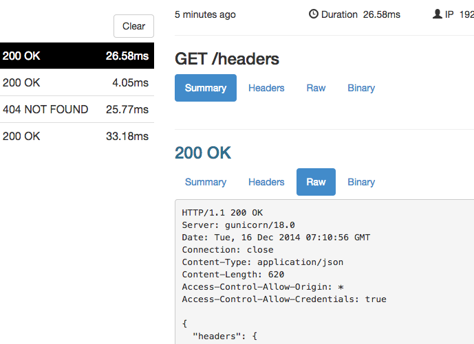
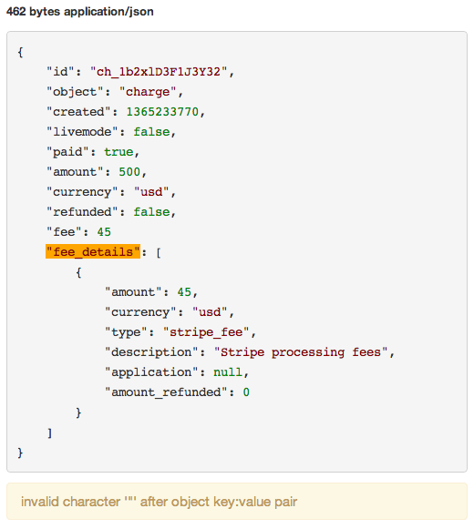
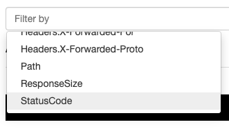
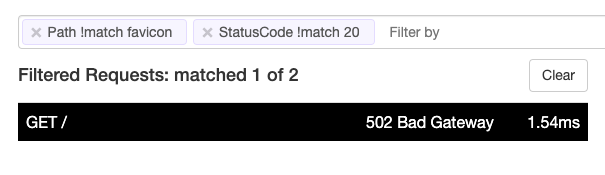
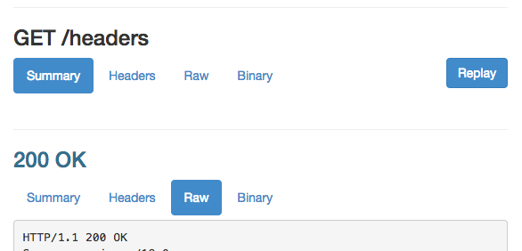
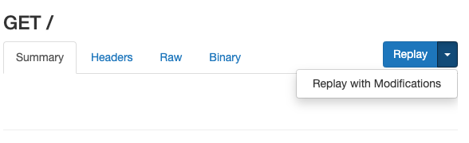
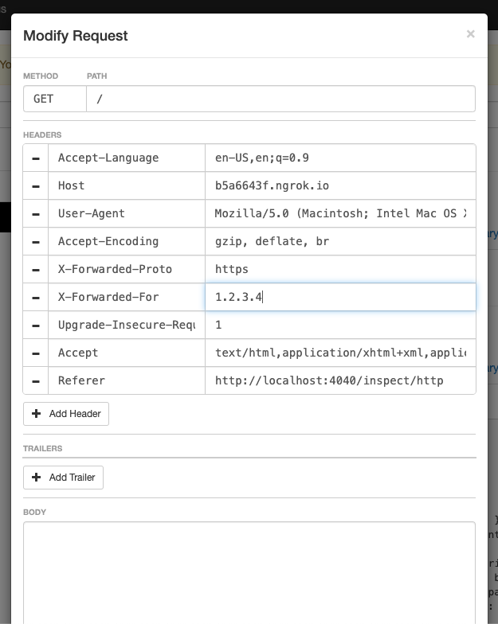
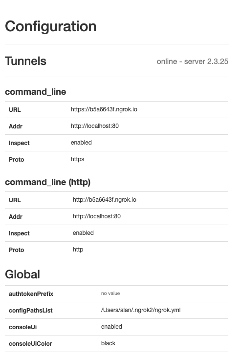
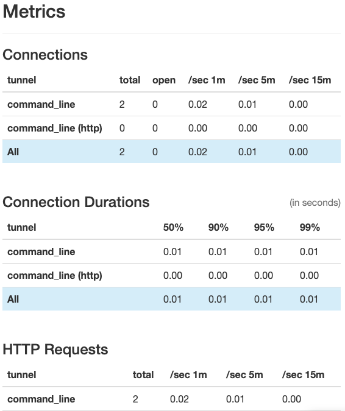

The ngrok CLI ships with a real-time inspection interface which allows you to see what traffic is sent to your upstream service and what responses it's returning.

The Web Inspection Interface is only available in the ngrok CLI and not in the ngrok SDKs.
If you want to view traffic across all endpoints, longer retention periods, or sharing traffic events with other teammates, check out the [Traffic Inspector in the ngrok Dashboard](/obs/traffic-inspection/#ngrok-traffic-inspector) instead.

## Inspecting requests

Every HTTP request through your endpoints appears in the inspection interface.
After you start the ngrok agent, open [http://localhost:4040](http://localhost:4040) in a browser on the same machine.
You can see all of the details of every request and response including the time, duration, source IP, headers, query parameters, request payload, and response body as well as the raw bytes on the wire.

The inspection interface has a few limitations.
If an entity-body is too long, ngrok may only capture the initial portion of the request body.
ngrok also doesn't display provisional 100 responses from a server.

Inspection is only supported for HTTP endpoints.
TCP and TLS endpoints don't support inspection and don't show up in the inspection interface.

<Frame caption="Detailed introspection of HTTP requests and responses">
  
</Frame>

## Request body validation

ngrok has special support for the most common data interchange formats in use on the web.
Any XML or JSON data in request or response bodies is automatically pretty-printed and checked for syntax errors.

<Frame caption="The location of a JSON syntax error is highlighted">
  
</Frame>

## Filtering requests

Your upstream service may receive many requests, but you usually only want to inspect some of them.
You can filter the requests that ngrok displays to you.
You can filter based on the request path, response status code, size of the response body, duration of the request, and the value of any header.

<Frame caption="Click the filter bar for filtering options">
  
</Frame>

You may specify multiple filters.
If you do, ngrok only shows requests that match all filters.

<Frame caption="Filter requests by path and status code">
  
</Frame>

## Replaying requests

Developing for webhooks issued by external APIs can often slow down your development cycle by requiring you do some work, like dialing a phone, to trigger the hook request.
ngrok allows you to replay any request with a single click, dramatically speeding up your iteration cycle.
Click **Replay** on any request in the web inspection UI to replay it.

Replay works via the local agent sending the request directly to your upstream service.
As such, the replayed request isn't subject to any policies that exist on your Cloud Endpoint since those are applied prior to the request reaching the local agent.
To replay the original request before the endpoint policies are applied, or to test new policies, use the [Traffic Inspector in the ngrok Dashboard](/obs/traffic-inspection/#ngrok-traffic-inspector).

<Frame caption="Replay any request against your web server with one click">
  
</Frame>

## Replaying modified requests

Sometimes you want to modify a request before you replay it to test a new behavior in your upstream service.

<Frame caption="Click the dropdown arrow on the 'Replay' button to modify a request before it is replayed">
  
</Frame>

The replay editor allows you to modify every aspect of the HTTP request before replaying it, including the method, path, headers, trailers, and request body.

<Frame caption="The request replay modification editor">
  
</Frame>

## ngrok agent status page

ngrok's local web interface has a dedicated status page that shows configuration and metrics information about the running ngrok process.
You can access it at [http://localhost:4040/status](http://localhost:4040/status).

The status page displays the configuration of each running endpoint and any global configuration options that ngrok has parsed from its configuration file.

<Frame caption="Endpoint and global configuration">
  
</Frame>

The status page also displays metrics about the traffic through each endpoint.
It displays connection rates and connection duration percentiles for all endpoints.
For HTTP endpoints, it also displays HTTP request rates and HTTP response duration percentiles.

<Frame caption="Endpoint traffic metrics">
  
</Frame>
