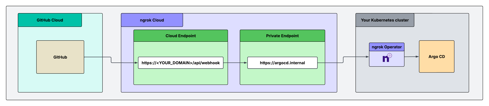

Argo CD polls Git every three minutes by default.
A GitHub webhook makes Argo CD refresh as soon as you push, but only if GitHub can reach Argo CD.
This guide connects GitHub Cloud to Argo CD in a private Kubernetes cluster with the [ngrok Kubernetes Operator](/gateway/k8s/).
ngrok checks the signature on each event and forwards only genuine events to Argo CD.
The cluster doesn't need an ingress or a public IP, and only requests with a valid GitHub signature reach Argo CD.

## What you'll build

/api/webhook. The Cloud Endpoint forwards the request to the private endpoint https://argocd.internal. The ngrok Operator in your Kubernetes cluster carries the request to Argo CD."
/>

You define both endpoints as Kubernetes resources, so you can keep them in Git with the rest of your Argo CD config:

- A [`CloudEndpoint`](/gateway/k8s/crds/cloudendpoint/) is the public URL you give to GitHub.
  Its Traffic Policy accepts only the `/api/webhook` path, verifies the GitHub signature, and rejects everything else.
- An [`AgentEndpoint`](/gateway/k8s/crds/agentendpoint/) with the internal URL `https://argocd.internal` points to the `argocd-server` Service.
  Only the Cloud Endpoint can send traffic to it.

## What you'll need

- An [ngrok account](https://dashboard.ngrok.com/signup) and an [API key](https://dashboard.ngrok.com/api-keys).
- The [ngrok CLI](/getting-started/) installed on your workstation.
- The [ngrok Kubernetes Operator](/gateway/k8s/installation/helm) installed in the cluster.
  The cluster needs outbound access on port 443.
- Argo CD installed in the cluster.
  This guide uses the default `argocd` namespace and `argocd-server` Service.
- Admin access to the GitHub repository or organization that sends the webhooks.
- `kubectl` access to the `argocd` namespace.

## 1. Serve Argo CD over HTTP inside the cluster

By default, `argocd-server` redirects plain HTTP requests to HTTPS.
GitHub doesn't follow redirects, so the webhook fails.
The ngrok Operator already encrypts traffic between the ngrok edge and the cluster, so you can let `argocd-server` accept plain HTTP inside the cluster:

```bash
kubectl -n argocd patch configmap argocd-cmd-params-cm \
  --type merge -p '{"data":{"server.insecure":"true"}}'
kubectl -n argocd rollout restart deployment argocd-server
```

<Note>
  This setting also affects any other ingress that sends traffic to `argocd-server`.
  If another ingress expects HTTPS on port `443`, check it before you make this change.
</Note>

## 2. Give Argo CD a private address

Create an `AgentEndpoint` that points to the `argocd-server` Service:

```yaml title="argocd-agentendpoint.yaml"
apiVersion: ngrok.k8s.ngrok.com/v1alpha1
kind: AgentEndpoint
metadata:
  name: argocd
  namespace: argocd
spec:
  url: https://argocd.internal
  upstream:
    url: http://argocd-server.argocd:80
```

```bash
kubectl apply -f argocd-agentendpoint.yaml
```

If you installed Argo CD with Helm, the Service name can include the release name.
Run `kubectl -n argocd get svc` to find it.

## 3. Store the signing secret in a vault

A `CloudEndpoint` lives in Git, so don't put the webhook secret in its policy.
Store the secret in [Secrets for Traffic Policy](/gateway/traffic-policy/secrets) instead.

Add your API key to the ngrok CLI:

```bash
ngrok config add-api-key <YOUR_API_KEY>
```

Generate a long random value, for example with `openssl rand -hex 32`.
Then create a vault and a secret:

```bash
ngrok api vaults create --name "webhook-secrets" --description "Webhook validation secrets"
ngrok api secrets create --name "github-secret" --value "<YOUR_GITHUB_WEBHOOK_SECRET>" --vault-id "<VAULT_ID>"
```

Replace `<VAULT_ID>` with the ID that the first command returns.

## 4. Create the CloudEndpoint and policy

```yaml title="argocd-cloudendpoint.yaml"
apiVersion: ngrok.k8s.ngrok.com/v1alpha1
kind: CloudEndpoint
metadata:
  name: argocd-webhooks
  namespace: argocd
spec:
  url: https://<YOUR_NGROK_DOMAIN>
  trafficPolicy:
    policy:
      on_http_request:
        - name: AllowOnlyWebhookPath
          expressions:
            - "req.url.path != '/api/webhook'"
          actions:
            - type: deny
              config:
                status_code: 404

        - name: VerifyAndForward
          actions:
            - type: verify-webhook
              config:
                provider: github
                secret: "${secrets.get('webhook-secrets', 'github-secret')}"
            - type: forward-internal
              config:
                url: https://argocd.internal
```

```bash
kubectl apply -f argocd-cloudendpoint.yaml
```

The policy does three things:

- The first rule returns a `404` for every path except `/api/webhook`, so even a correctly signed request can only reach the webhook path.
- The [`verify-webhook`](/gateway/traffic-policy/actions/verify-webhook) action checks the GitHub signature.
  A request with a bad or missing signature gets a `403`.
- The [`forward-internal`](/gateway/traffic-policy/actions/forward-internal) action sends verified requests to `argocd.internal`.
  The path stays the same, so Argo CD receives the request at `/api/webhook`.

## 5. Configure the GitHub webhook

In your GitHub repository, go to **Settings** → **Webhooks** → **Add webhook**.
For an organization-wide webhook, go to the organization's **Settings** → **Webhooks** instead.

Set these fields:

| Field | Value |
| --- | --- |
| **Payload URL** | `https://<YOUR_NGROK_DOMAIN>/api/webhook` |
| **Content type** | `application/json` (Argo CD doesn't accept the default `application/x-www-form-urlencoded`) |
| **Secret** | The same value as `<YOUR_GITHUB_WEBHOOK_SECRET>` |
| **SSL verification** | Enabled |
| **Which events** | **Just the push event** |

Click **Add webhook**.
GitHub sends a `ping` event right away.

## 6. Test it

1. In GitHub, open the webhook, click the **Recent Deliveries** tab, and find the `ping` event.
   Click **Redeliver**.
2. In the ngrok dashboard, open the [Traffic Inspector](https://dashboard.ngrok.com/traffic-inspector).
   The request to `/api/webhook` shows a `200` response from Argo CD.
3. Push a commit to a repository that an Argo CD Application tracks.
   Then check the `argocd-server` logs for the event:

   ```bash
   kubectl -n argocd logs deploy/argocd-server | grep -i "push event"
   ```

   The Application refreshes within seconds.
   If it has auto-sync turned on, it also syncs.

4. Confirm that ngrok rejects a forged request:

   ```bash
   curl -i -X POST https://<YOUR_NGROK_DOMAIN>/api/webhook \
     -H "Content-Type: application/json" \
     -H "X-GitHub-Event: push" \
     -d '{}'
   ```

   You get a `403 Forbidden`, and Argo CD doesn't see the request.

5. Confirm that other paths are blocked: `curl -i https://<YOUR_NGROK_DOMAIN>/` returns a `404`.
