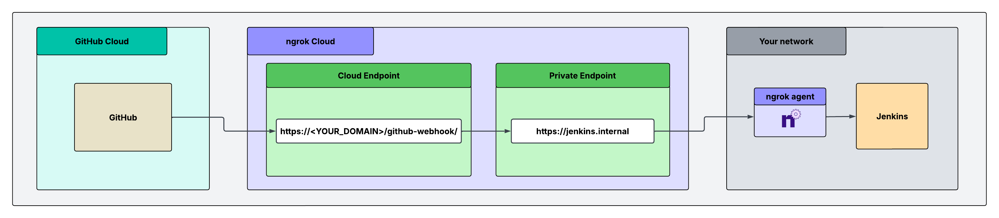

This guide connects GitHub Cloud to a Jenkins server that runs on a VM or server in your network.
GitHub sends push and pull request events to one public ngrok URL.
ngrok checks the signature on each event and forwards only genuine events to Jenkins.
Jenkins stays private: you don't open an inbound port, and only requests with a valid GitHub signature reach it.

## What you'll build

/github-webhook/. The Cloud Endpoint forwards the request to the private endpoint https://jenkins.internal. The ngrok agent in your private network carries the request to Jenkins."
/>

- A [Cloud Endpoint](/gateway/endpoints/cloud-endpoints/) is the public URL you give to GitHub.
  Its Traffic Policy accepts only the `/github-webhook/` path, verifies the GitHub signature, and rejects everything else.
- An internal [Agent Endpoint](/gateway/endpoints/agent-endpoints/), `https://jenkins.internal`, runs on the Jenkins host.
  Only the Cloud Endpoint can send traffic to it.

## What you'll need

- An [ngrok account](https://dashboard.ngrok.com/signup) and an [API key](https://dashboard.ngrok.com/api-keys).
- The [ngrok agent](/getting-started/) installed on the Jenkins host.
  The host needs outbound access on port 443.
- Admin access to the GitHub repository or organization that sends the webhooks.
- Jenkins with the [GitHub plugin](https://plugins.jenkins.io/github/) installed.
  Pipelines that use the GitHub Branch Source plugin also receive events through the GitHub plugin.

## 1. Give Jenkins a private address

On the Jenkins host, start an internal Agent Endpoint that points to Jenkins.
Jenkins listens on port `8080` by default.
Change the port if yours is different.

```bash
ngrok http 8080 --url https://jenkins.internal
```

For production, add the endpoint to your [agent config file](/gateway/agent/config/) and [run the agent as a service](/gateway/agent/service) so it restarts with the host.

## 2. Store the signing secret in a vault

Keep the webhook secret out of your policy.
Store the secret in [Secrets for Traffic Policy](/gateway/traffic-policy/secrets) instead.

Add your API key to the ngrok CLI:

```bash
ngrok config add-api-key <YOUR_API_KEY>
```

Generate a long random value, for example with `openssl rand -hex 32`.
Then create a vault and a secret:

```bash
ngrok api vaults create --name "webhook-secrets" --description "Webhook validation secrets"
ngrok api secrets create --name "github-secret" --value "<YOUR_GITHUB_WEBHOOK_SECRET>" --vault-id "<VAULT_ID>"
```

Replace `<VAULT_ID>` with the ID that the first command returns.

## 3. Create the Cloud Endpoint and policy

Go to [**Endpoints**](https://dashboard.ngrok.com/endpoints), click **New +**, then **Cloud Endpoint**.
Enter the domain you want GitHub to send events to, for example `ci-webhooks.example.com`.

Replace the default Traffic Policy with this policy:

```yaml
on_http_request:
  - name: AllowOnlyWebhookPath
    expressions:
      - "req.url.path != '/github-webhook/'"
    actions:
      - type: deny
        config:
          status_code: 404

  - name: VerifyAndForward
    actions:
      - type: verify-webhook
        config:
          provider: github
          secret: "${secrets.get('webhook-secrets', 'github-secret')}"
      - type: forward-internal
        config:
          url: https://jenkins.internal
```

The policy does three things:

- The first rule returns a `404` for every path except `/github-webhook/`, so even a correctly signed request can only reach the webhook path.
- The [`verify-webhook`](/gateway/traffic-policy/actions/verify-webhook) action checks the GitHub signature.
  A request with a bad or missing signature gets a `403`.
- The [`forward-internal`](/gateway/traffic-policy/actions/forward-internal) action sends verified requests to `jenkins.internal`.
  The path stays the same, so Jenkins receives the request at `/github-webhook/`.

## 4. Configure the GitHub webhook

In your GitHub repository, go to **Settings** → **Webhooks** → **Add webhook**.
For an organization-wide webhook, go to the organization's **Settings** → **Webhooks** instead.

Set these fields:

| Field | Value |
| --- | --- |
| **Payload URL** | `https://<YOUR_NGROK_DOMAIN>/github-webhook/` (keep the trailing slash) |
| **Content type** | `application/json` |
| **Secret** | The same value as `<YOUR_GITHUB_WEBHOOK_SECRET>` |
| **SSL verification** | Enabled |
| **Which events** | **Just the push event**, or select **Pushes** and **Pull requests** |

Click **Add webhook**.
GitHub sends a `ping` event right away.

## 5. Configure Jenkins

Turn on the webhook trigger for each job that should build on push:

- **Freestyle and Pipeline jobs:** open the job's **Configure** page.
  Under **Build Triggers**, select **GitHub hook trigger for GITScm polling**.
- **Multibranch Pipeline and Organization Folder jobs:** no trigger setting is needed.
  The GitHub Branch Source plugin reacts to the events.

The repository URL in the job must match the repository that sends the event.
Otherwise, Jenkins accepts the event but doesn't start a build.

### Let GitHub own the webhook

The GitHub plugin can create webhooks for you, but it registers the Jenkins URL, which is private.
Go to **Manage Jenkins** → **System** → **GitHub** and make sure **Manage hooks** is off for your GitHub server.
Add the webhook in GitHub by hand, as in step 4.

## 6. Test it

1. In GitHub, open the webhook, click the **Recent Deliveries** tab, and find the `ping` event.
   Click **Redeliver**.
2. In the ngrok dashboard, open the [Traffic Inspector](https://dashboard.ngrok.com/traffic-inspector).
   The request to `/github-webhook/` shows a `200` response from Jenkins.
3. Push a commit to the repository.
   A build starts on each job that has the trigger turned on.
4. Confirm that ngrok rejects a forged request:

   ```bash
   curl -i -X POST https://<YOUR_NGROK_DOMAIN>/github-webhook/ \
     -H "Content-Type: application/json" \
     -H "X-GitHub-Event: push" \
     -d '{}'
   ```

   You get a `403 Forbidden`, and Jenkins doesn't see the request.

5. Confirm that other paths are blocked: `curl -i https://<YOUR_NGROK_DOMAIN>/login` returns a `404`.
