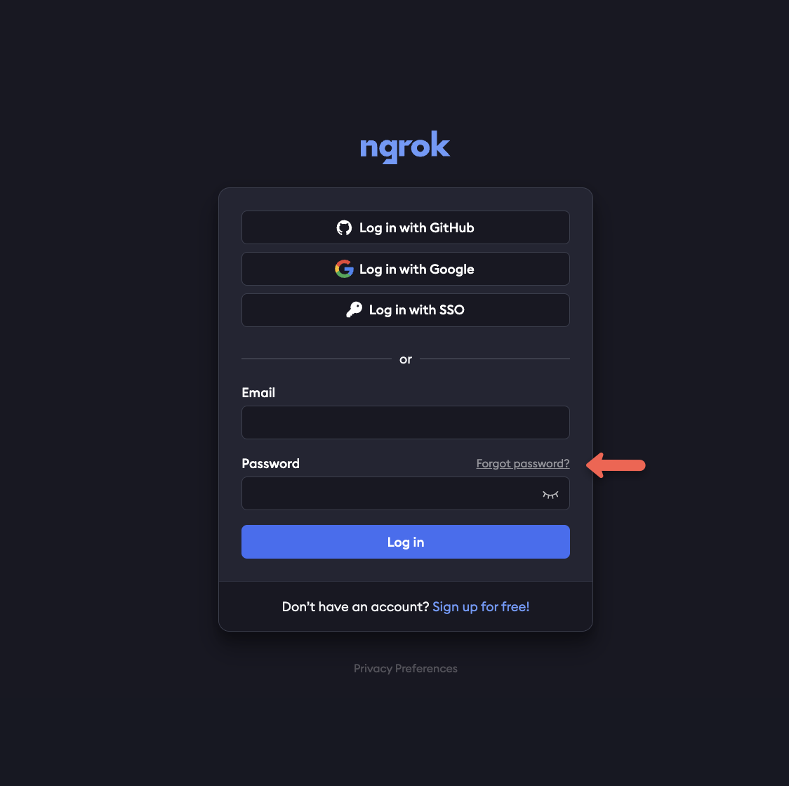
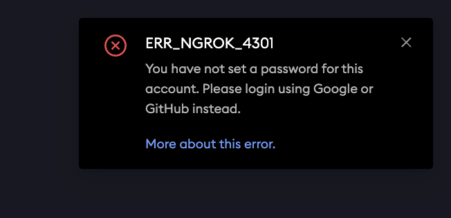
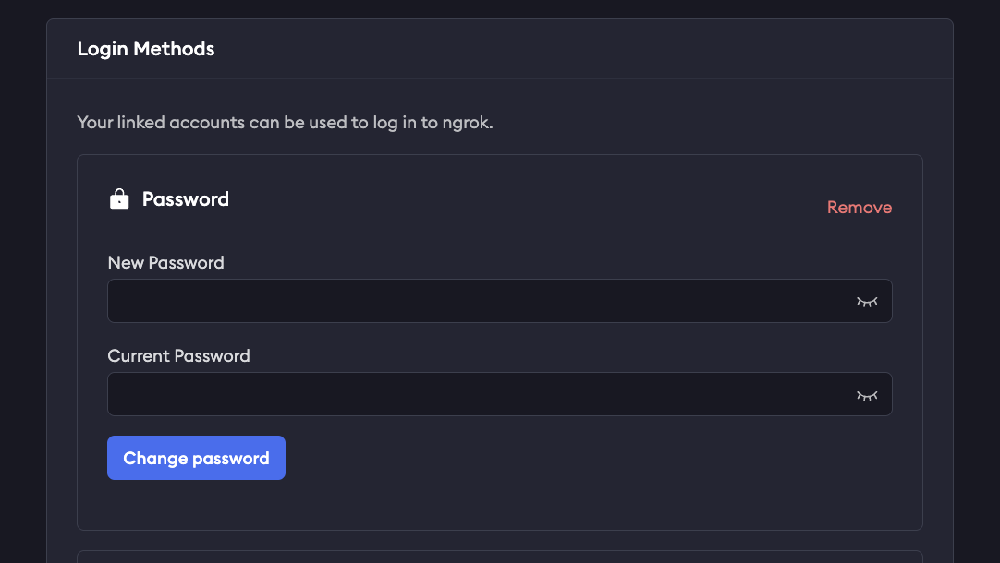
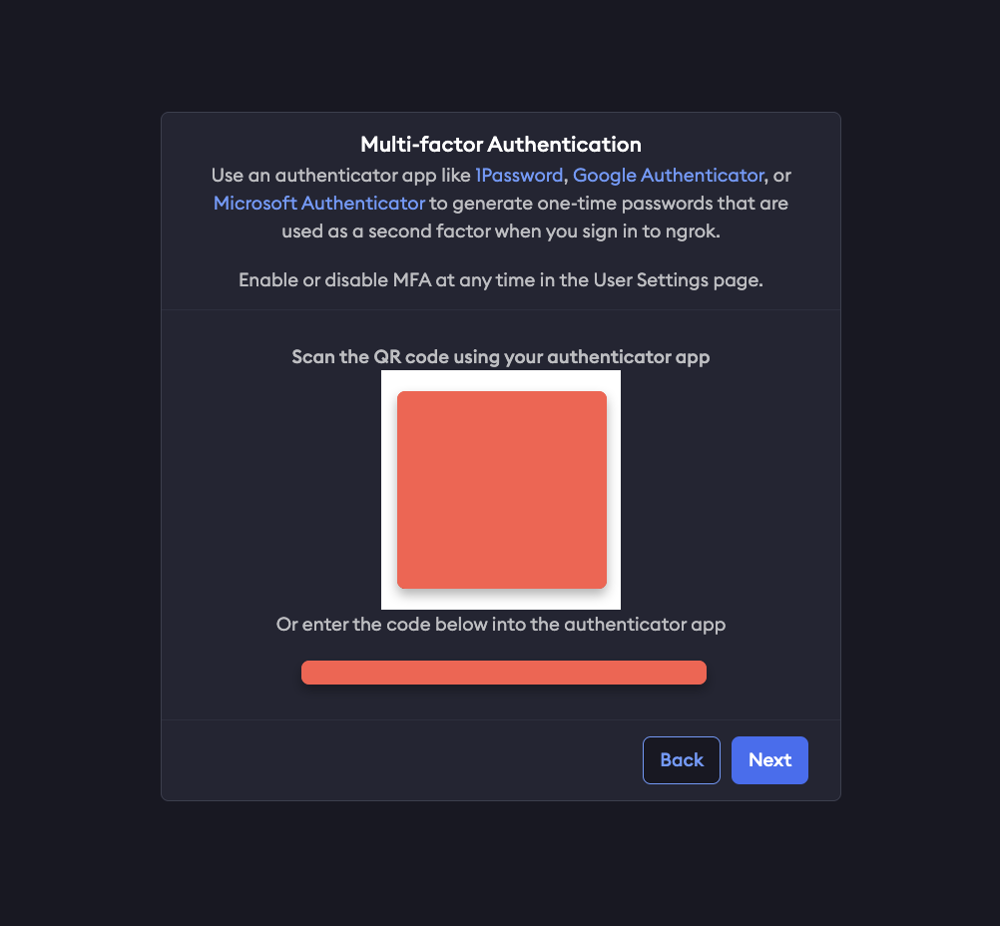
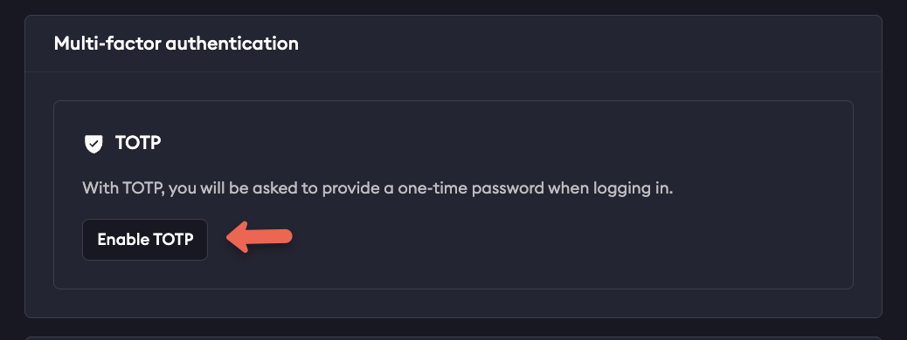
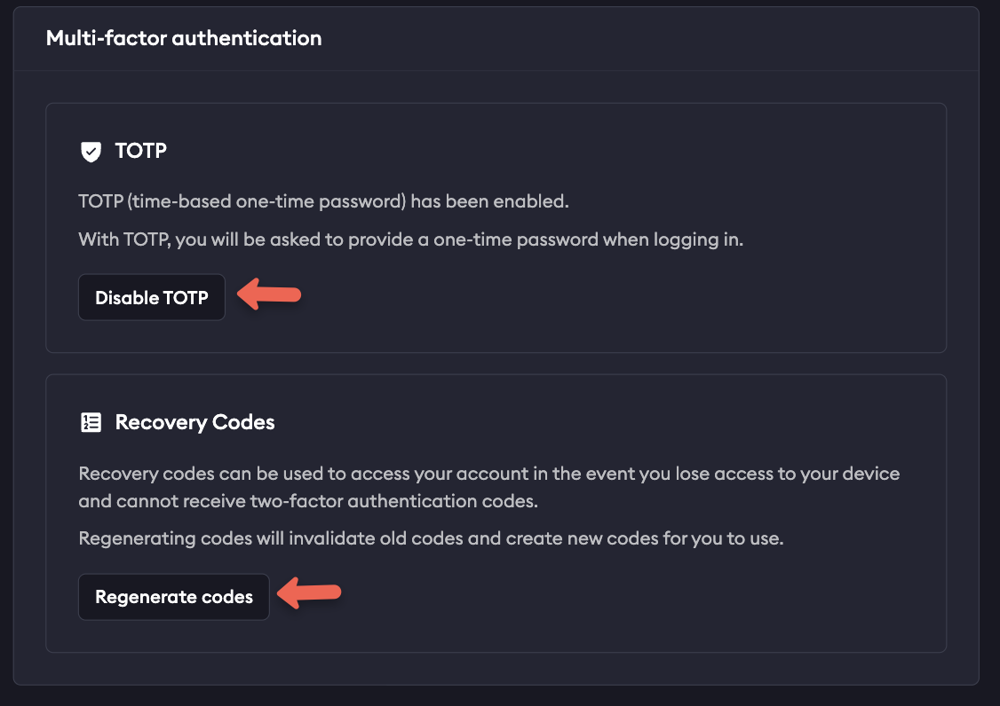

## Users

Users are members of your Account that can log into the dashboard, start agents, create endpoints, and access the API.

- Users have one or more [Credentials](#credentials) that they use to authenticate with the ngrok service.
- Users aren't uniquely owned by an account.
  A User can be a member of more than one account.
- Users are subject to [Role Based Access Control](/iam/rbac) that allows you to restrict what actions Users can take within the account.
- Whenever a User takes an action within an account, the corresponding [Event Log](/obs/) attributes the event to the User by recording it as the Principal.

## Dashboard access

Users can log into the [ngrok dashboard](https://dashboard.ngrok.com).
You can configure your account to restrict how users authenticate to the dashboard.
ngrok supports dashboard authentication through an email and password, an IdP like GitHub or Google, or your own [single sign-on IdP](/iam/sso) like Okta or Azure AD.

Users can log into your ngrok Account's dashboard.
Normally, users enter an email and password to log into the ngrok dashboard, but you can configure your ngrok account to require additional factors or require SSO.

[Service Users](/iam/service-users/), by contrast, can't log into the dashboard.

### Password management

You can sign up for an ngrok account using an email and password, or using an SSO provider.

#### Reset a forgotten password

If you've forgotten your password, you can reset it at any time on the [login page](https://dashboard.ngrok.com/login).

From there, enter the email address you used to sign in to your ngrok account, and select **recover password**.

<Note>
If you use SSO to sign in, and haven't also added a password to your account, you can't reset your password.
</Note>

Ensure you enter the correct email, and check your spam folder to confirm you've received the password reset email.
If you can't remember what email you used, try other possible addresses, or review past invoices to find the correct email.

If you receive an `ERR_NGROK_4301` error, try signing in with SSO, as you didn't set a password for the account.

If you don't receive the email after completing these steps, contact support for further assistance.

#### Change your password

If you already have access to your account but want to change the password, you can do so in your user settings.
Select your username in the dashboard and select **User Settings**.
From there, enter your old password and the new one you want to use.

### MFA

Multi-factor authentication (MFA) allows you to add an extra layer of security to your ngrok account by requiring an additional authentication factor to log in.
At the moment, MFA only supports one-time passwords ([TOTP](https://en.wikipedia.org/wiki/Time-based_one-time_password)) as an additional factor.

You can configure your ngrok account to enforce that all users have MFA enabled.

#### Set up MFA during signup

When you sign up for an ngrok account for the first time, ngrok prompts you to set up multi-factor authentication with a QR code to use with your preferred authenticator.

From here, open your preferred authenticator (such as Google Authenticator, Microsoft Authenticator, Authy, Duo, or Okta Authenticator) and scan the QR code provided.
After you set up your preferred authenticator, you enter a code from that authenticator each time you log into your ngrok account.

#### Recovery codes

ngrok also provides a list of recovery codes, which you can copy and paste elsewhere or download directly.
Store these recovery codes in a secure location, as you can use them to access your account if you lose access to your authenticator device.

#### Manage MFA settings

You can enable or disable MFA at any time after you log into your account by selecting your username in your dashboard, and then **User Settings**.
Scroll down to **Multi Factor Authentication** and select **Enable** or **Disable**, or generate new recovery codes if needed.

#### Lost access or recovery

If you lose access to your authenticator or device and don't have recovery codes downloaded, or have used all available codes, email [support@ngrok.com](mailto:support@ngrok.com) with the email you use to sign in to your ngrok account.

### Single sign-on

Users can also log in with a federated IdP through single sign-on.
You can configure your ngrok account to require all of your users to log in with single sign-on.
See the [single sign-on documentation](/iam/sso) for more details on configuring it.

### IP restrictions

In addition to the normal authentication factors required to log into the ngrok dashboard, you can also configure your ngrok account to further restrict dashboard access to a set of IP CIDR blocks.

Always use dashboard IP restrictions in a warning mode first to test that you won't accidentally lock yourself out of your account if you restrict access to IPs that you can't use.

You can configure IP Restrictions manually on the ngrok dashboard or programmatically through the API with a `type` of `dashboard`.

- **[IP Restrictions on your ngrok dashboard](https://dashboard.ngrok.com/ip-restrictions)**
- **[IP Restrictions API Resource](/api-reference/iprestrictions/list/)**

## Credentials

Users own one or more credentials that enable them to start [Agents](/gateway/agent/) and make API requests.

Credentials are assigned an owner when they're created, and the owner can't be changed.
All Credentials have a Principal owner which is either a User or a Service User.

Credentials are [Authtokens](/gateway/agent/authtokens), [API Keys](/api/#authentication), and [SSH Public Keys](/gateway/agent/ssh-reverse-tunnel-agent/#authentication).

## Disabling

You can disable users in your account.
When a User is disabled, it can't log into the dashboard, start an ngrok agent, or make API requests.
All of its [Credentials](#credentials) remain but can't be used.
You can re-enable a User at any time.

[Administrators](/iam/rbac/#administrator) and [Team Managers](/iam/rbac/#team) can disable and enable Users.

## Deletion

When you delete a User from an account, ngrok revokes all of its [Credentials](#credentials) for that account, and any agents using them stop working.
If you have an automated process or agent using ngrok, use a [Service User](/iam/service-users) instead.

When you delete a User from your account, keep in mind that the User itself isn't deleted; it's only removed from the Account.
It can continue to use and access other Accounts it's a member of.

[Administrators](/iam/rbac/#administrator) and [Team Managers](/iam/rbac/#team) can delete Users.

## Provisioning

Provisioning is about how you add new users to your account.
You can configure your ngrok account with your preferred provisioning method on your [Account Settings page](https://dashboard.ngrok.com/settings).
By default, you provision new users by inviting them to join your Account with Invitations.

If you have configured [SSO](#single-sign-on), you can also add users to your account through the SCIM or JIT provisioning methods.

### Invitations

Invitations are the default user provisioning mechanism.
You invite new users by email address.
They must log in or sign up with that email address to accept the invitation.
When you issue the invitation, if you're using [RBAC](/iam/rbac), you can also choose the permissions they receive when they join the account by accepting the invitation.

### Just-in-time

If you have configured a federated SSO IdP on your account, you can configure just-in-time (JIT) provisioning.
When JIT provisioning is enabled, if a user signs in with your configured IdP and they don't have a matching ngrok User, ngrok automatically provisions one for them the first time they log in and adds that user as a member of your account.

ngrok always assigns JIT-provisioned users a Read/Write [Developer role](/iam/rbac#developer) and an Invite [Team role](/iam/rbac#team).

### SCIM

If you have configured a federated SSO IdP on your account, you can configure SCIM provisioning.
When SCIM provisioning is enabled, the IdP is responsible for making calls to ngrok's SCIM API.

ngrok always assigns users provisioned by SCIM a Read/Write [Developer role](/iam/rbac#developer) and an Invite [Team role](/iam/rbac#team).

Users provisioned by SCIM can't change their name or email address because the IdP manages it.

See the [SCIM documentation](/iam/sso/#scim) for more details.
