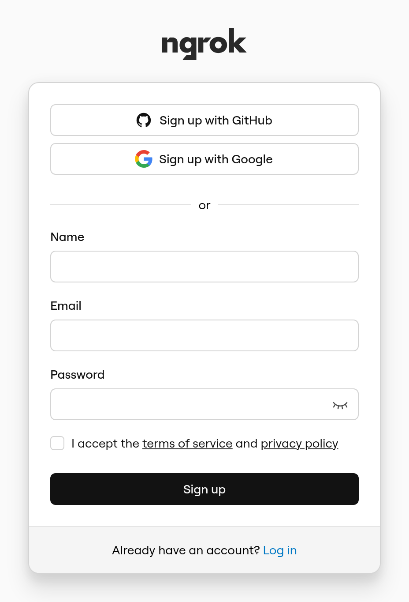
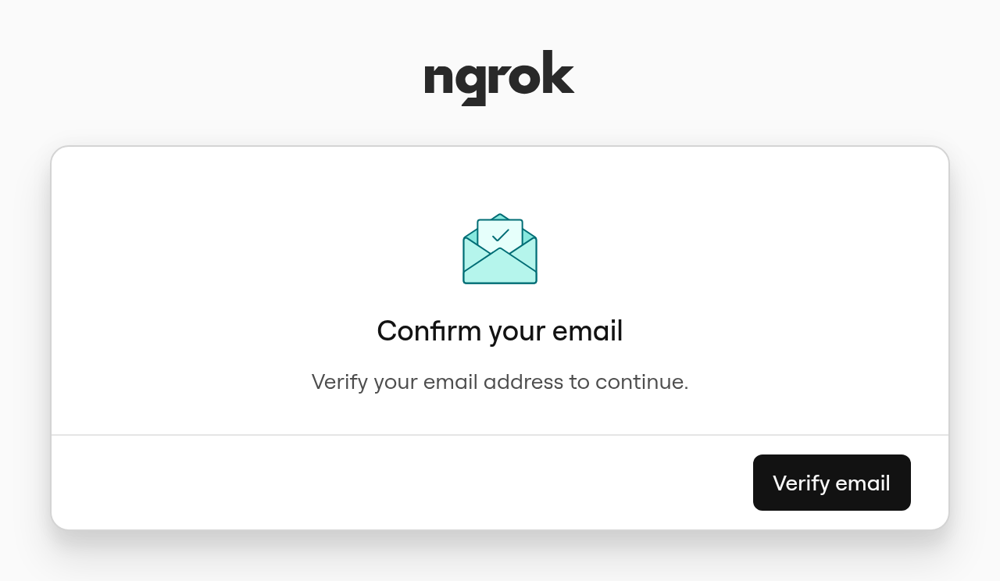
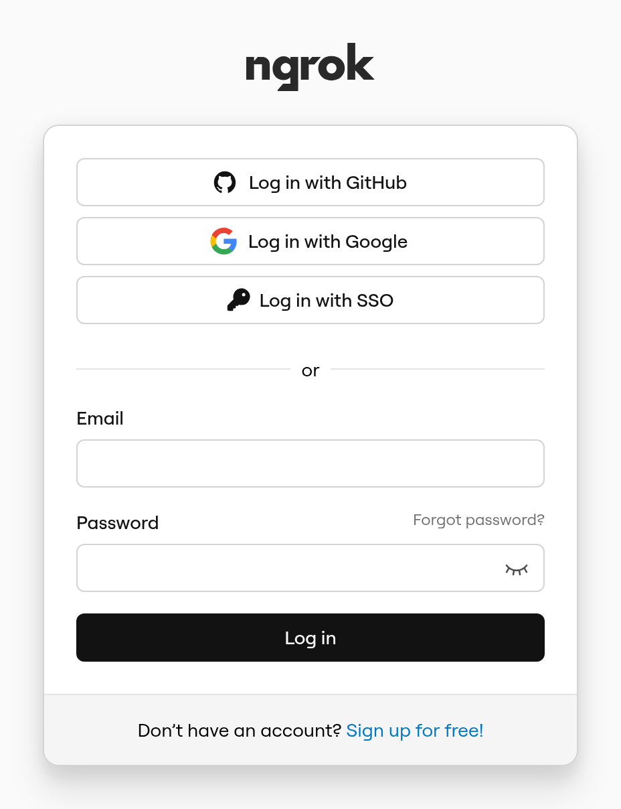
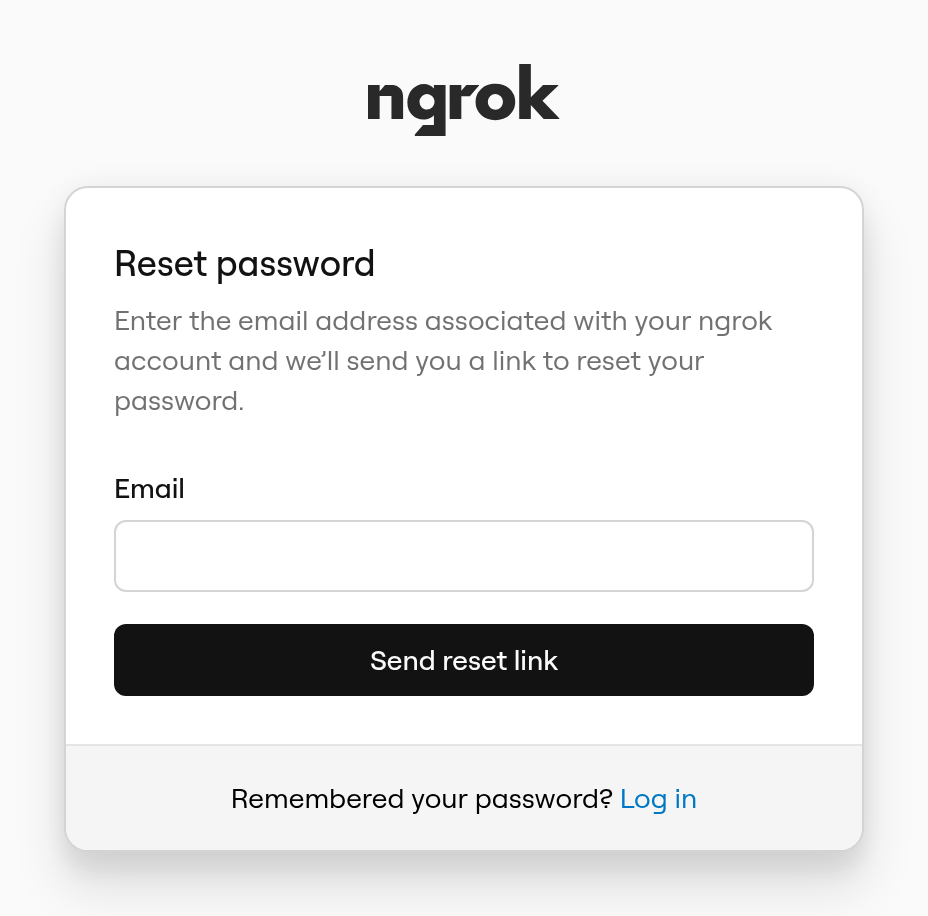
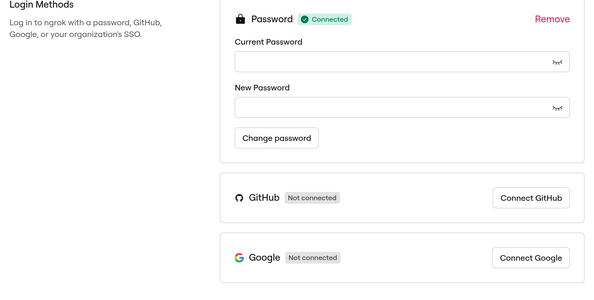
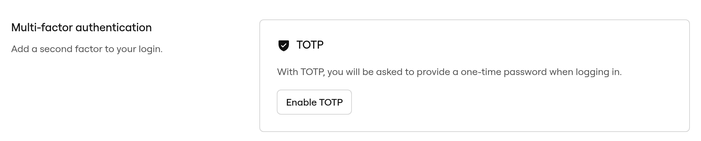
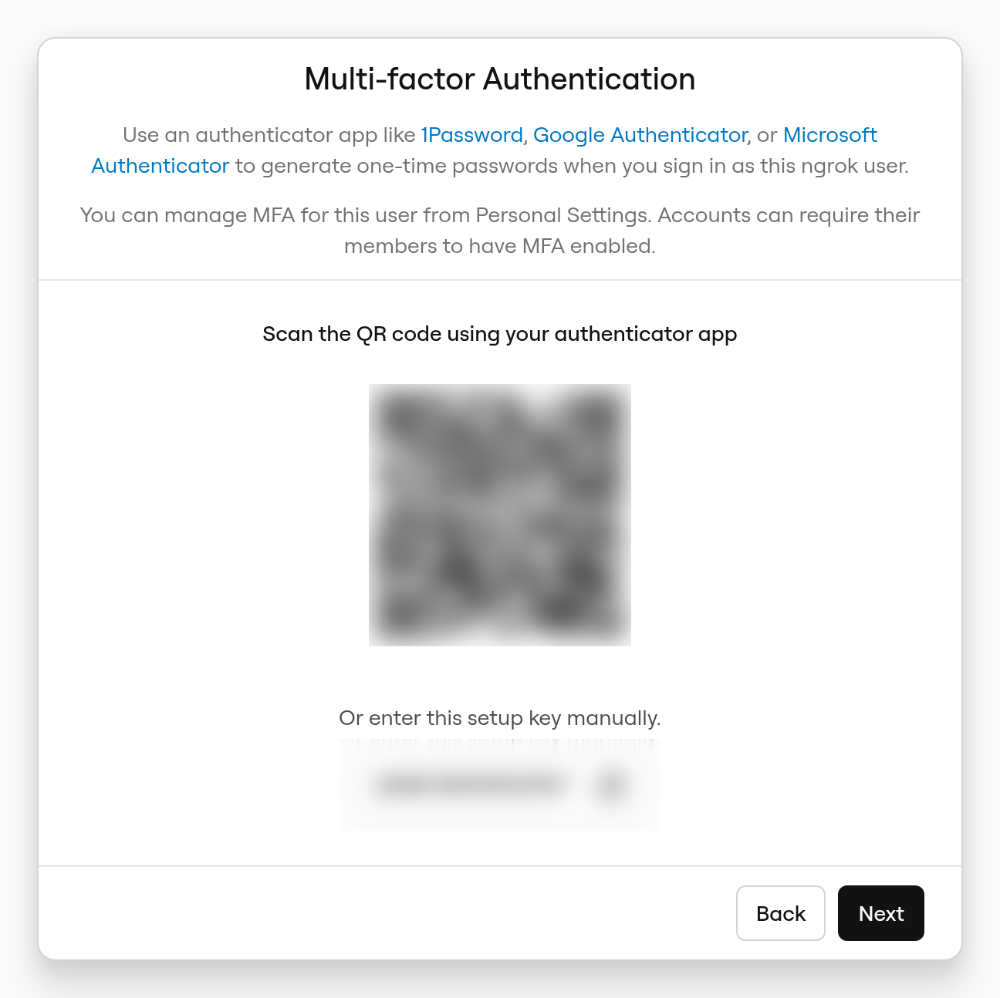
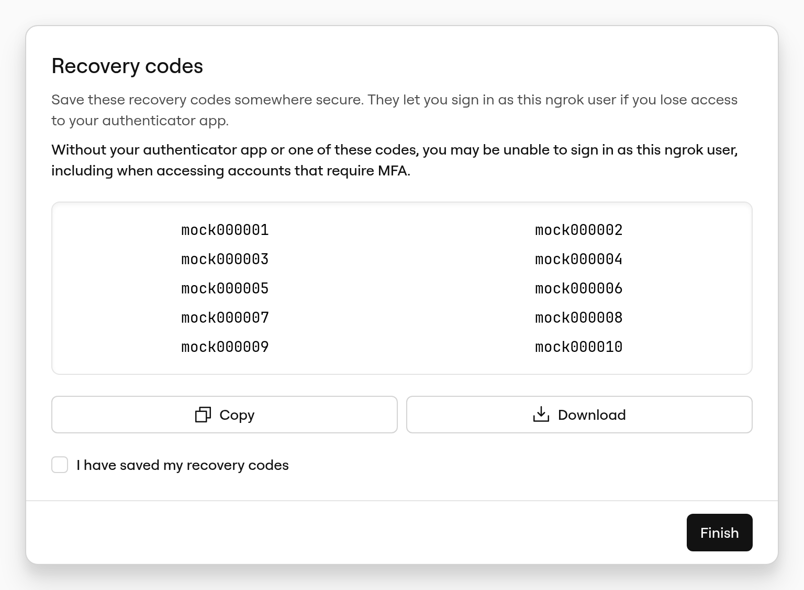
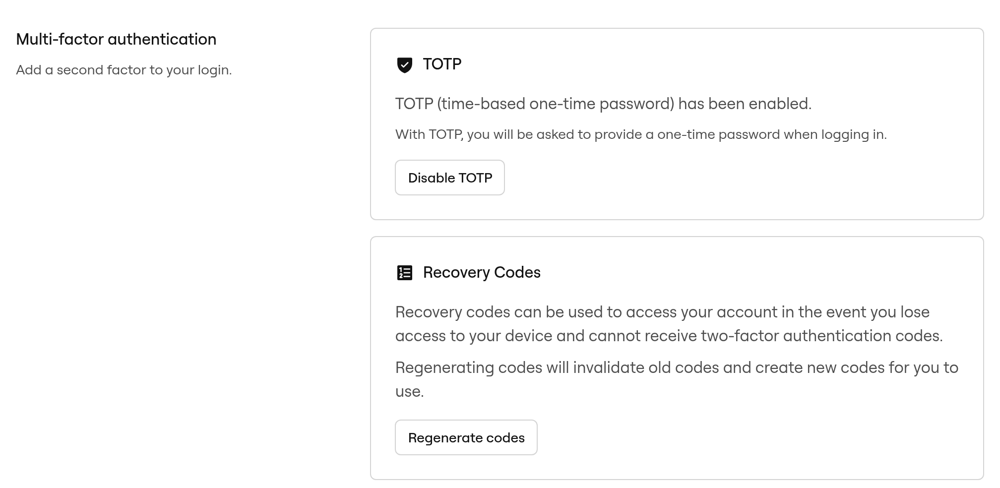
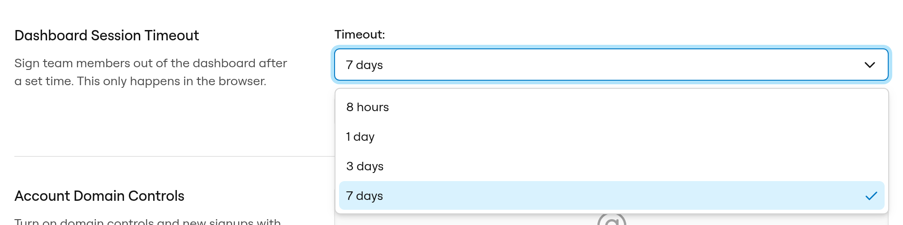

## Users

Users are members of your Account who can log into the dashboard, start agents, create endpoints, and access the API.

- Users have one or more [Credentials](#credentials) that they use to authenticate with the ngrok service.
- Users aren't uniquely owned by an account.
  A User can be a member of more than one account.
- Users are subject to [Role Based Access Control](/iam/rbac) that lets you restrict what actions Users can take within the account.
- Whenever a User takes an action within an account, the corresponding [Event Log](/obs/) attributes the event to the User by recording it as the Principal.

## Dashboard access

Users sign in to the [ngrok dashboard](https://dashboard.ngrok.com) and the AI Gateway app at [app.ngrok.ai](https://app.ngrok.ai) through a shared login page at [login.ngrok.com](https://login.ngrok.com).
ngrok supports sign-in with an email and password, with GitHub or Google, or with your own [Single Sign-On IdP](/iam/sso) like Okta or Azure AD.
You can configure your ngrok account to require additional factors or require SSO.

If you're a member of more than one account, ngrok asks you to choose an account on the **Select an account** page after you sign in.

[Service Users](/iam/service-users/), by contrast, can't log into the dashboard.

### Sign up and verify your email

Sign up for an ngrok account at [login.ngrok.com/signup](https://login.ngrok.com/signup) with an email and password, or with GitHub or Google.

If someone invited you to their account, open the link in the invitation email to sign up.
The sign-up form uses the email address that received the invitation, and you can't change it.

When you sign up with an email and password, ngrok sends you an email titled "Verify email address for ngrok.com" from `no-reply@ngrok.com`.
You can't continue into ngrok until you verify your email address:

1. Open the link in the verification email.
   You can open it in any browser or on any device.
1. On the **Confirm your email** page, click **Verify email**.
1. Return to the tab where you signed up.
   Sign-up continues there on its own.
   If you closed that tab, click **Continue to ngrok** on the **Email verified** page instead.

If the email doesn't arrive, go back to the tab where you signed up and click **Resend email**.

You don't need to verify your email when you sign up with GitHub, Google, or SSO, or with an email and password from an invitation.

An account can't start agents or endpoints until its admin's email address is verified.
See [ERR_NGROK_123](/errors/err_ngrok_123) and [ERR_NGROK_382](/errors/err_ngrok_382).

### Password management

#### Reset a forgotten password

If you've forgotten your password, reset it from the [login page](https://login.ngrok.com):

1. Click **Forgot password?**.

   

1. Enter the email address you use to sign in and click **Send reset link**.

   

1. Open the link in the email within 15 minutes, then set your new password.

Resetting your password signs you out of all your existing sessions.

<Note>
If you signed up with GitHub, Google, or SSO and never added a password to your account, you have no password to reset.
Sign in with that method instead.
</Note>

Ensure you enter the correct email, and check your spam folder to confirm you've received the password reset email.
If you can't remember what email you used, try other possible addresses or review past invoices to find the correct email.

If you don't receive the email after completing these steps, contact support for further assistance.

#### Change your password

If you can sign in and want to change your password, go to **Settings > Security & Access** ([dashboard.ngrok.com/user/settings/security](https://dashboard.ngrok.com/user/settings/security)).
In the **Login Methods** section, enter your **Current Password** and **New Password**, then click **Change password**.
Changing your password signs you out of your other sessions.

### MFA

Multi-Factor Authentication (MFA) adds an extra layer of security to your ngrok account by requiring an additional authentication factor to log in.
Currently, MFA only supports one-time passwords ([TOTP](https://en.wikipedia.org/wiki/Time-based_one-time_password)) as an additional factor.
Each one-time password works only once.
If you need to sign in again right away, wait for your authenticator to show a new code.

Account admins can require MFA for every member in **Settings > Auth**, under **Multi-Factor Authentication (MFA)**.
When an account requires MFA, members who haven't set it up must do so the next time they log in at login.ngrok.com before they can continue.

#### Set up MFA

1. Go to **Settings > Security & Access** ([dashboard.ngrok.com/user/settings/security](https://dashboard.ngrok.com/user/settings/security)).
   In the **Multi-factor authentication** section, click **Enable TOTP**.

   

1. Scan the QR code with your authenticator app, such as 1Password, Google Authenticator, or Microsoft Authenticator.
   You can also enter the setup key manually.
   Click **Next**.

   

1. Enter the current 6-digit code from your authenticator app and click **Continue**.

After you set up MFA, ngrok asks for a code from your authenticator each time you log in.

#### Recovery codes

After you enable TOTP, ngrok shows you a list of recovery codes.
Copy or download them and store them in a secure location.
You can use them to log in if you lose access to your authenticator app.
Select **I have saved my recovery codes**, then click **Finish**.

#### Manage MFA settings

You can disable MFA or generate new recovery codes at any time in **Settings > Security & Access**.
Click **Disable TOTP** to turn MFA off, or **Regenerate codes** to replace your recovery codes.
Regenerating codes invalidates your old ones.

#### Lost access or recovery

If you lose access to your authenticator or device and don't have recovery codes downloaded, or have used all available codes, email [support@ngrok.com](mailto:support@ngrok.com) with the email you use to sign in to your ngrok account.

### Single sign-on

Users can also log in with a federated IdP through single sign-on.
You can configure your ngrok account to require all of your users to log in with single sign-on.
See the [Single Sign-On documentation](/iam/sso) for more details on configuring it.

If you belong to more than one account, each account applies its own SSO requirements.
See [Users in multiple accounts](/iam/sso#users-in-multiple-accounts).

### IP restrictions

In addition to the normal authentication factors required to log into the ngrok dashboard, you can also configure your ngrok account to further restrict dashboard access to a set of IP CIDR blocks.

Always use Dashboard IP Restrictions in a warning mode first to test that you won't accidentally lock yourself out of your account if you restrict access to IPs that you can't use.

You can configure IP Restrictions manually on the ngrok dashboard or programmatically through the API with a `type` of `dashboard`.

- **[IP Restrictions on your ngrok dashboard](https://dashboard.ngrok.com/ip-restrictions)**
- **[IP Restrictions API Resource](/api-reference/iprestrictions/list/)**

### Dashboard session timeout

The dashboard session timeout controls how long a dashboard sign-in lasts for your account before users must sign in again.
ngrok counts the timeout from when the user signed in, not from their last activity.
It applies only to dashboard browser sessions, not to agents or API keys.

You can choose 8 hours, 1 day, 3 days, or 7 days.
The default and maximum is 7 days, and you can't set a custom value.

To change it, you must be an account admin:

1. Go to **Settings > Auth** ([dashboard.ngrok.com/settings/auth](https://dashboard.ngrok.com/settings/auth)).
1. In the **Dashboard Session Timeout** section, choose a **Timeout** and click **Update**.

A shorter timeout signs out users whose sessions are past the new limit within about 15 minutes.
A longer timeout applies from each user's next sign-in.

The dashboard session timeout requires the Identity and Access Governance Suite add-on on a Pay-as-you-go plan.
If you try to set it without the add-on, ngrok returns [ERR_NGROK_DASH_SESSION_LIFETIME_NOT_ALLOWED](/errors/err_ngrok_dash_session_lifetime_not_allowed).
See [pricing](/pricing-limits/how-ngrok-charges) for details.

## Credentials

Users own one or more credentials that enable them to start [Agents](/gateway/agent/) and make API requests.

ngrok assigns each Credential an owner when you create it, and you can't change the owner.
All Credentials have a Principal owner, which is either a User or a Service User.

Credentials are [Authtokens](/gateway/agent/authtokens), [API Keys](/api/#authentication), and [SSH Public Keys](/gateway/agent/ssh-reverse-tunnel-agent/#authentication).

## Disabling

You can disable users in your account.
When a User is disabled, it can't log into the dashboard, start an ngrok agent, or make API requests.
All of its [Credentials](#credentials) remain but can't be used.
You can re-enable a User at any time.

[Administrators](/iam/rbac/#administrator) or [Team Managers](/iam/rbac/#team) can disable and enable Users.

## Deletion

When you delete a User from an account, ngrok revokes all of its [Credentials](#credentials) for that account, and any agents using them stop working.
If you have an automated process or agent using ngrok, use a [Service User](/iam/service-users) instead.

When you delete a User from your account, keep in mind that ngrok doesn't delete the User itself—it only removes the User from the Account.
The User can continue to use and access other Accounts it's a member of.

[Administrators](/iam/rbac/#administrator) or [Team Managers](/iam/rbac/#team) can delete Users.

## Provisioning

Provisioning is about how you add new users to your account.
You can configure your ngrok account with your preferred provisioning method in the **User Provisioning / SCIM** section of [Settings > Auth](https://dashboard.ngrok.com/settings/auth).
By default, you provision new users by inviting them to join your Account with Invitations.

If you've configured [SSO](#single-sign-on), you can also add users to your account through the SCIM or JIT provisioning methods.

### Invitations

Invitations are the default user provisioning mechanism.
You invite new users by email address.
They must log in or sign up with that email address to accept the invitation.
When you issue the invitation, if you're using [RBAC](/iam/rbac), you can also choose the permissions they receive when they join the account by accepting the invitation.

### Just-in-time

If you've configured a federated SSO IdP on your account, you can configure Just-in-Time (JIT) provisioning.
When JIT provisioning is enabled, if a user signs in with your configured IdP and they don't have a matching ngrok User, ngrok automatically provisions one for them the first time they log in and adds that user as a member of your account.
Before ngrok creates the user, they must accept ngrok's terms of service and privacy policy.

ngrok always assigns JIT-provisioned users a Read/Write [Developer role](/iam/rbac#developer) and an Invite [Team role](/iam/rbac#team).

### SCIM

If you've configured a federated SSO IdP on your account, you can configure SCIM provisioning.
When SCIM provisioning is enabled, the IdP is responsible for making calls to ngrok's SCIM API.

ngrok always assigns users provisioned by SCIM a Read/Write [Developer role](/iam/rbac#developer) and an Invite [Team role](/iam/rbac#team).

Users provisioned by SCIM can't change their name or email address because the IdP manages them.

See the [SCIM documentation](/iam/sso/#scim) for more details.
